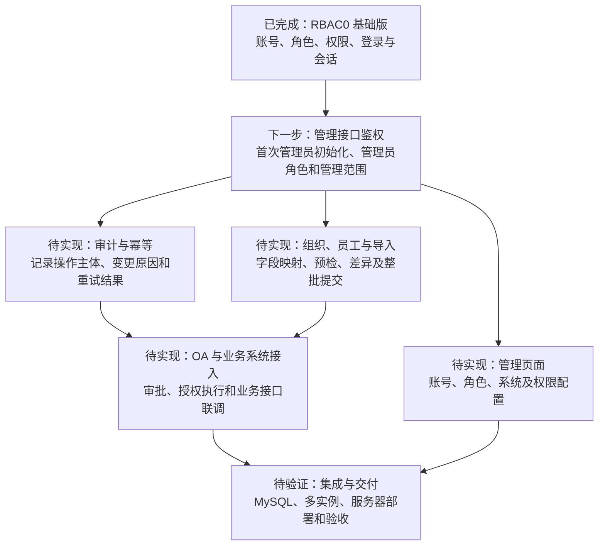
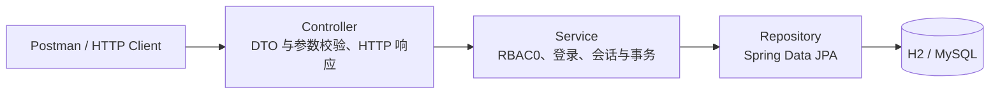

# nified-permission-system · 统一权限管理系统

面向多个业务系统的统一账号、角色与功能权限管理后端。项目采用 **RBAC0** 模型：用户通过角色获得权限，多个角色的权限取并集，业务接口在后端校验当前登录状态和有效权限。

**当前阶段：后端基础版已实现，后续重点是管理端鉴权与业务接入。** 已完成账号、角色、业务系统、菜单权限管理，BCrypt 登录，JWT 与数据库会话校验，以及权限回收示例。当前通过 Postman、HTTP Client 或自动测试进行验收。

最近一次代码验证：**2026-10-19，Java 21 下 `clean package` 成功，13 项测试通过**。测试使用 H2，包含 HTTP 接口、事务回滚与并发登录场景；真实 MySQL、多实例和目标服务器部署仍需单独验收。

快速入口：[本地启动](#本地启动) · [Postman 验收](#postman-与-http-client-验收) · [开发顺序](#后续开发顺序) · [文档导航](#文档导航)

## 项目目标与业务范围

为业务系统提供统一的账号与功能授权基础能力：登记系统和权限，为角色配置权限，为用户分配角色，并在每次受保护请求中重新判断是否允许操作。当前示例为报销列表接口，需要 `expense:list` 权限。

| 对象 | 当前职责 | 示例 |
| --- | --- | --- |
| 用户 | 统一账号、显示名称、密码摘要、启用状态 | 张三的登录账号 |
| 角色 | 一组可以分配给用户的功能权限 | 财务查看员 |
| 业务系统 | 权限所属的应用系统及启用状态 | 财务系统 |
| 权限 | 菜单或接口操作的唯一编码 | `expense:list` |
| 登录会话 | JWT 对应的有效登录记录 | 登录、注销、账号变更后的失效校验 |

当前管理类 API 用于本地演示，**尚未实现管理员身份认证和管理范围校验**；受到登录与功能权限保护的业务示例是 `GET /api/demo/expenses`。管理员网页、部门管理范围、Excel 导入和 OA 审批接入属于后续任务。

## 当前进度

| 模块 | 状态 | 已有能力或待办 | 依据 |
| --- | --- | --- | --- |
| RBAC0 基础模型 | 已实现 | 用户、角色、业务系统、权限及分配关系；权限并集合并去重 | [设计说明](docs/rbac0-design.md) |
| 管理 API | 基础 CRUD 已实现 | 支持账号和授权配置；管理员鉴权及管理范围待补 | [接口清单](docs/rbac-api.md) |
| 登录与会话 | 已实现 | BCrypt、JWT、持久化会话、注销；改密码、停用和删除账号撤销全部会话 | [会话改进说明](docs/reference-improvements.md) |
| 后端权限校验 | 示例已实现 | 权限回收、角色停用或系统停用影响后续请求 | [接口验收](docs/rbac-api.md) |
| CloneFactory | 已集成 | DTO 注解声明映射，编译期生成对象拷贝代码 | [集成说明](docs/clonefactory.md) |
| 数据库与部署配置 | 脚本已提供 | H2 本地运行；MySQL 全量及增量 SQL、生产配置和部署步骤 | [部署说明](docs/deployment-two-servers.md) |
| 自动测试 | 13 项通过 | 11 项 HTTP/事务/并发测试、1 项 RBAC 集成测试、1 项上下文测试 | [测试代码](src/test/java/com/cdwy/permission) |
| 组织、员工与数据导入 | 待实现 | 确认部门、员工和权限清单字段，再实现导入及校验 | [后续建议](docs/reference-improvements.md) |
| 管理页面与 OA 接入 | 待实现 | 管理页面联调、审批请求及执行结果衔接 | [后续建议](docs/reference-improvements.md) |
| MySQL、多实例与服务器验收 | 待验证 | 真实数据库兼容性、跨实例失效、部署重启及演示 | [部署说明](docs/deployment-two-servers.md) |

## 后续开发顺序

优先补齐管理接口鉴权，再扩展组织、审批和页面。下图表示建议的推进顺序，具体接口和任务随业务规则细化。



数据库版本管理工具、真实 MySQL 并发测试和部署验证应随功能迭代补齐。实现依据及第一轮借鉴内容见 [参考改进说明](docs/reference-improvements.md)。

## 技术栈

| 领域 | 当前选型 |
| --- | --- |
| Java | JDK 21 |
| 后端框架 | Spring Boot 4.0.8、Spring Web MVC |
| 持久化 | Spring Data JPA / Hibernate |
| 数据库 | H2：本地开发和测试；MySQL：生产配置目标 |
| 密码与令牌 | Spring Security Crypto / BCrypt、JJWT 0.12.6 |
| 对象映射 | CloneFactory 注解处理器、Lombok |
| 构建 | Maven |
| 接口风格 | REST API、JSON、Bearer Token |
| 验证工具 | JUnit、MockMvc、Postman、HTTP Client |

## 分层结构与授权规则



Controller 接收请求，Service 处理账号及授权规则，Repository 访问数据库。DTO 和实体之间通过 CloneFactory 生成的方法转换，生成文件由编译器维护。

- 用户启用时，有效权限为所有启用角色中、所属系统也启用的权限并集，按权限编码去重；用户停用时权限为空。
- JWT 标识登录凭证。受保护接口还会检查数据库会话是否存在、用户是否启用，以及会话与令牌的用户和时间是否匹配。
- 注销仅撤销当前会话；重置密码、停用或删除账号撤销该账号全部会话。重新启用账号后必须重新登录。
- 角色或权限被回收后，后续请求重新计算权限，通常返回 `403`；登录会话失效时返回 `401`。
- 登录与账号变更锁定同一账号行，密码修改和会话撤销在同一事务中提交或回滚。

六张 RBAC 核心表和一张登录会话表的关系、约束与完整业务流程见 [RBAC0 设计说明](docs/rbac0-design.md)。

## 文档导航

| 需要了解的内容 | 阅读入口 |
| --- | --- |
| 建设目标、模型、数据表与业务流程 | [RBAC0 设计说明](docs/rbac0-design.md) |
| 请求体、接口路径、HTTP 状态及手动验收顺序 | [API 与验收说明](docs/rbac-api.md) |
| 导入 Postman 后按顺序执行 | [Postman 验收集合](docs/postman/unified-permission-system.postman_collection.json) |
| 首次编译、`@CopyTo` / `@CopyFrom` 等映射注解 | [CloneFactory 集成说明](docs/clonefactory.md) |
| 新 MySQL 数据库建表 | [全量 SQL](docs/database-mysql.sql) |
| 已有六张表的旧版数据库升级 | [登录会话增量 SQL](docs/migrations/20261019-login-sessions.sql) |
| 服务器分工、环境变量、systemd 和验收 | [两台服务器部署说明](docs/deployment-two-servers.md) |
| 参考 RBAC-admin 后的实现、验证及后续建议 | [参考改进说明](docs/reference-improvements.md) |

## 当前目录

```text
nified-permission-system/
├── README.md
├── pom.xml
├── mvnw / mvnw.cmd
├── src/
│   ├── main/
│   │   ├── java/com/cdwy/permission/
│   │   │   ├── config/         密码编码配置
│   │   │   ├── controller/     HTTP 接口和异常处理
│   │   │   ├── dto/            请求、响应及映射声明
│   │   │   ├── entity/         JPA 实体
│   │   │   ├── repository/     数据访问
│   │   │   └── service/        RBAC0、JWT 与会话逻辑
│   │   └── resources/
│   │       ├── application.properties
│   │       └── application-prod.yml
│   └── test/java/com/cdwy/permission/
├── third-party/clonefactory/  内置对象映射注解处理器
└── docs/
    ├── rbac0-design.md
    ├── rbac-api.md
    ├── clonefactory.md
    ├── reference-improvements.md
    ├── database-mysql.sql
    ├── deployment-two-servers.md
    ├── migrations/
    └── postman/
```

## 本地启动

### 1. 准备 JDK 21 和 Maven

在 PowerShell 中确认 `java -version` 和 `mvn -version` 都使用 Java 21。当前开发机可使用以下配置；其他电脑把 `JAVA_HOME` 改为实际 JDK 21 路径。IDEA 的 Project SDK 和 Maven Runner JRE 也应选择 JDK 21。

```powershell
$env:JAVA_HOME = 'C:\Users\姚景云\.jdks\corretto-21.0.12.1'
$env:Path = "$env:JAVA_HOME\bin;$env:Path"
java -version
mvn -version
```

### 2. 打开项目

当前开发机的 IDEA 项目位于 `D:\nified-permission-system`，Git 工作副本位于 `D:\CodexData\workspaces\nified-permission-system-github`。任选实际使用的项目根目录执行后续命令，修改后保持两份源码一致。

首次在其他电脑获取项目时，可在 D 盘工作目录克隆并通过 IDEA 打开 `pom.xml`：

```powershell
git clone https://github.com/yyyjjjj949/nified-permission-system.git D:\CodexData\workspaces\nified-permission-system
cd D:\CodexData\workspaces\nified-permission-system
```

### 3. 安装内置 CloneFactory 依赖并构建

在项目根目录执行。首次构建、注解处理器源码变更或清空 Maven 缓存后，需要先执行第一条命令：

```powershell
mvn "-Dmaven.repo.local=D:\CodexData\cache\m2" -f third-party/clonefactory/pom.xml clean install
mvn "-Dmaven.repo.local=D:\CodexData\cache\m2" clean package
```

主项目已在 `pom.xml` 配置注解处理器。DTO 使用 `@CopyTo`、`@CopyFrom`、`@CopyNotNullTo` 声明映射，Service 调用 `CloneFactory.copy(...)` 和 `copyNotNull(...)`。生成源码位于 `target/generated-sources/annotations`，详见 [CloneFactory 说明](docs/clonefactory.md)。

### 4. 启动应用

```powershell
mvn "-Dmaven.repo.local=D:\CodexData\cache\m2" spring-boot:run
```

默认地址为 `http://localhost:8080`。浏览器、Postman 或 HTTP Client 请求：

```http
GET http://localhost:8080/hello
```

预期返回：

```json
{"message":"unified-permission-system"}
```

本地默认使用 H2 内存数据库，应用停止后演示账号、授权和会话会清空。若 8080 已占用，可临时使用其他端口：

```powershell
mvn "-Dmaven.repo.local=D:\CodexData\cache\m2" "-Dspring-boot.run.arguments=--server.port=8081" spring-boot:run
```

## Postman 与 HTTP Client 验收

Postman 可直接导入 [验收集合](docs/postman/unified-permission-system.postman_collection.json)，将 `baseUrl` 设为 `http://localhost:8080`，使用其他端口时同步修改。集合面向空的演示数据库，按编号执行，自动保存创建记录的 ID 和登录令牌。

使用 HTTP Client 手动验证时，按 [API 文档](docs/rbac-api.md) 依次完成：创建业务系统、用户并设置密码，创建角色与 `expense:list` 权限，配置角色权限和用户角色，再登录并调用业务接口。接口中的 ID 使用创建响应返回的实际值。

| 验收场景 | 预期结果 |
| --- | --- |
| 多个角色拥有部分重复权限 | 返回权限并集，同一编码只保留一项 |
| 登录后携带 JWT，且拥有 `expense:list` | `GET /api/demo/expenses` 返回 `200` |
| 回收相关角色或权限，或停用角色、业务系统 | 同一有效 JWT 调用对应业务接口返回 `403` |
| 注销、重置密码、停用或删除账号 | 相关旧 JWT 返回 `401` |
| 停用账号后再次启用 | 旧 JWT 仍为 `401`，重新登录后可获取有效令牌 |
| 同一账号登录两次，只注销第一个会话 | 第一个 JWT 失效，另一个会话继续有效 |

携带令牌的请求示例：

```http
GET http://localhost:8080/api/demo/expenses
Authorization: Bearer <登录响应中的 accessToken>
```

Postman 集合覆盖基础授权、登录、回收和注销流程；改密码、停用再启用、删除账号和系统停用的补充验收见 [会话与状态验收](docs/rbac-api.md#新增会话与状态验收)。

## 测试与构建

在已安装 CloneFactory 的项目根目录执行：

```powershell
# 运行测试
mvn "-Dmaven.repo.local=D:\CodexData\cache\m2" clean test

# 运行测试并生成可执行 JAR
mvn "-Dmaven.repo.local=D:\CodexData\cache\m2" clean package
```

| 测试类 | 数量 | 覆盖内容 |
| --- | --- | --- |
| `AuthenticationHttpIntegrationTests` | 11 | HTTP 状态、密码重置、停用再启用、删除账号、独立验证器共享注销、系统停用、权限回收、非法令牌、事务回滚，以及登录和密码重置的两种并发顺序 |
| `RbacServiceIntegrationTests` | 1 | RBAC0 权限并集、权限回收、密码登录与注销 |
| `NifiedPermissionSystemApplicationTests` | 1 | 应用上下文加载 |

测试不启动监听端口。测试报告在 `target/surefire-reports`，可执行包为 `target/nified-permission-system-0.0.1-SNAPSHOT.jar`；构建产物不提交到 Git。

## MySQL 与服务器部署

新数据库使用 [全量建表脚本](docs/database-mysql.sql)。旧版已有六张 RBAC 表的数据库先执行 [会话表增量脚本](docs/migrations/20261019-login-sessions.sql)，再统一升级应用实例。旧令牌没有对应的持久化会话，升级后需重新登录。生产配置使用 `ddl-auto=validate`，不会自动执行这些 SQL。

`prod` 配置通过以下环境变量读取连接信息和密钥：

| 变量 | 用途 |
| --- | --- |
| `DB_URL` | MySQL JDBC 连接地址 |
| `DB_USERNAME` / `DB_PASSWORD` | 数据库账号与密码 |
| `PERMISSION_JWT_SECRET` | JWT 签名密钥，至少 32 字节 |
| `PERMISSION_JWT_EXPIRATION_SECONDS` | 令牌有效期，默认 `7200` 秒 |
| `SERVER_PORT` | 生产配置的监听端口，默认 `8080` |

设置环境变量后启动打包产物：

```powershell
java -jar target/nified-permission-system-0.0.1-SNAPSHOT.jar --spring.profiles.active=prod
```

推荐最小拓扑为“一台应用服务器 + 一台 MySQL 服务器”。多个应用实例必须使用相同 JWT 密钥和同一数据库；会话表不保存明文 JWT 或密码。真实数据库兼容性、跨实例注销、进程重启和服务器演示需要按 [部署说明](docs/deployment-two-servers.md) 验证。

## 开发与文档维护

后续功能建议按“业务规则 → API 与模型设计 → 测试场景 → 实现 → 联调验收”的顺序推进：

1. 明确操作主体、管理范围、权限变更规则和失败结果。
2. 将接口、模型及数据库变更写入对应的 `docs/` 文档，已有数据库提供增量 SQL。
3. 用测试验证允许、拒绝、状态失效，以及需要关注的事务和并发行为。
4. 实现后同步更新 README 的进度、文档入口和验收证据，再提交代码与文档。

当前进度以仓库源码、测试和配套文档为依据。后续可继续细化任务认领、接口契约、部门规则及审批流程。密码、真实 JWT 密钥、数据库连接凭据和员工导入数据不提交到 Git。

## 参考与改进

本项目参考 [Noah-hope/RBAC-admin](https://github.com/Noah-hope/RBAC-admin) 的项目文档组织、账号与会话生命周期、事务边界和接口验收思路，结合自身 RBAC0 模型逐步实现。第一轮改进及验证边界见 [参考改进说明](docs/reference-improvements.md)。

项目仓库：[yyyjjjj949/nified-permission-system](https://github.com/yyyjjjj949/nified-permission-system)。
