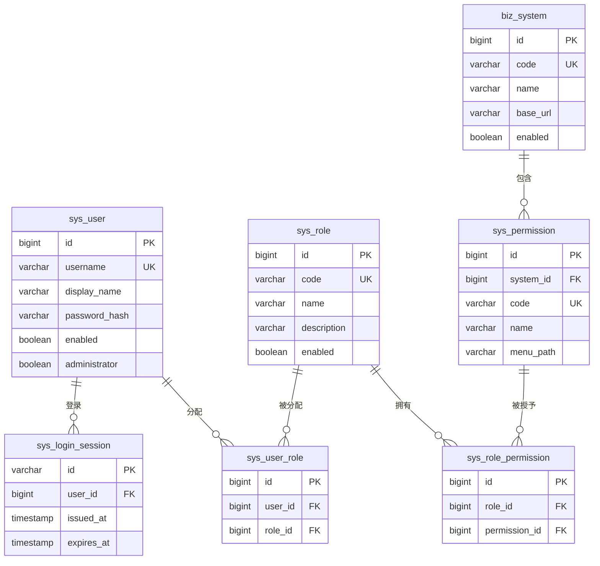
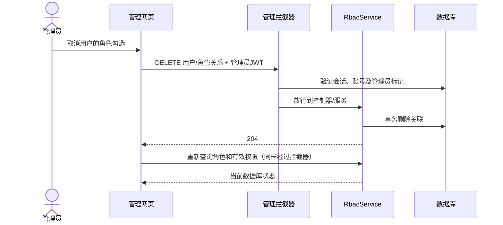
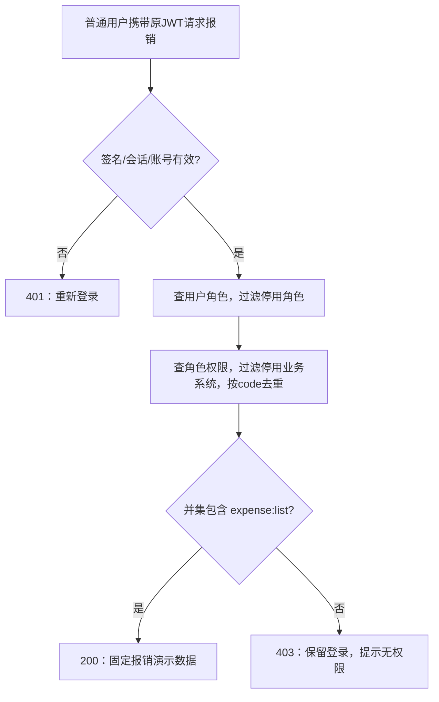

# 第一次检查详细设计

> 历史资料：适用于 2026-10-21 初版。当前文档见 [课程检查材料目录](../submission/README.adoc)。

## 1. 需求、问题与方案

多个业务系统需要知道“谁能执行什么操作”。如果直接给每个人逐项配置权限，岗位调整时容易漏改；如果只隐藏页面按钮，用户仍可直接发送 HTTP 请求绕过限制。因此采用 RBAC0：把权限组成角色，再把角色分给用户。每次业务请求都在后端读取当前授权。

本阶段提供七组功能：登录注销、用户管理、角色管理、业务系统管理、权限管理、两类授权关系维护、有效权限与报销示例验证。用户可有多个角色，权限只取并集，没有拒绝权限、继承层级或互斥规则。

现有项目是 Spring Boot 4、JPA、CloneFactory，管理功能数量小。前端采用三个静态文件 `index.html`、`app.css`、`app.js`，由同一个 Spring Boot 应用发布。无需额外前端服务器、依赖下载或跨域设置；同学可沿着一个按钮对应一个 API 理解实现。列表与就地表单是主要交互，不增加仪表盘和无意义统计。

## 2. 数据库关系

| 表 | 主要约束与含义 |
|---|---|
| sys_user | username 唯一且非空（64）；display_name 非空（128）；密码只保存 BCrypt 摘要，未设置密码时不能登录；enabled 与 administrator 非空。administrator 默认 false |
| sys_role | code 唯一非空（64），name 非空（128），description 可空（255），enabled 非空 |
| biz_system | code 唯一非空（64），name 非空（128），base_url 可空（255），enabled 非空；这里只登记系统，不自动接入真实业务 |
| sys_permission | code 全局唯一非空（128），name 非空（128），menu_path 非空（255），system_id 为外键；无独立启停字段 |
| sys_user_role | user_id、role_id 非空外键，二者组合唯一；重复分配不新增重复记录 |
| sys_role_permission | role_id、permission_id 非空外键，二者组合唯一 |
| sys_login_session | UUID 字符串 id 是 JWT 的 jti；用户外键非空；签发/到期时间非空；按 user_id、expires_at 建索引；不存完整 JWT |

除会话 UUID 外，各表 ID 由数据库自增生成。用户名、各类编码创建后不通过更新接口修改；权限所属系统也固定。删除用户先删会话和用户角色，删除角色先删两类关联，删除系统先删其权限及角色权限，操作在事务中进行，避免留下悬空关联。数据库唯一约束是并发重复创建的最后防线，冲突返回 409。

MySQL 全量脚本为 [database-mysql.sql](../database-mysql.sql)。已有七表数据库需另执行 [20261021-administrator.sql](../migrations/20261021-administrator.sql)；`CREATE TABLE IF NOT EXISTS` 不会给旧表补字段。迁移不将既有普通账号自动升级为管理员。真实 MySQL 本次未运行。

## 3. 管理员与普通用户边界

采用**单一全局管理员标记**，与业务角色分开。原因是本阶段只需要解释“谁能配置 RBAC”，不需要实现可委派的管理员层次。即使创建名为 admin 的业务角色，也不会成为管理员；管理员访问报销仍须获得 expense:list。

`AdminBootstrap` 在应用启动时调用事务服务 `AdminBootstrapService.initialize`。两个环境变量均未提供则不初始化；提供时校验用户名和密码。账号不存在且数据库没有管理员时才创建。相同管理员重复初始化直接保留现有密码和会话；撞到普通账号或试图创建第二个管理员则启动失败。没有 Web 初始化入口，也没有 HTTP 接口可修改 administrator。部署引导仅支持单实例顺序执行，**不保证多个实例同时首次初始化的互斥**。

首次管理员不能被普通管理 API 停用或删除，避免演示时把唯一管理员锁在外面。可以设置新密码，但随后需重新登录。忘记管理员密码的恢复不通过公开接口解决；内存演示环境停止后重建即可，持久化环境的受控恢复尚未实现。

`ApiAccessConfig` 为 `/api/**` 默认要求管理员，只显式放行 login、logout、me 和 expenses 四个路径；其中 me 和 expenses 自己校验当前登录身份，expenses 另校验业务权限。管理接口的 GET 也受保护，普通用户只能通过 me 查看自己的权限。静态页面可以公开加载，拿到网页不等于有权调用 API。

JWT 不包含可被信任的权限列表，后端先验签，再按 jti/用户/时间核对数据库会话和账号启用状态。前端 JWT 只存标签页内存，刷新页面需重新登录；不同标签页可独立演示两个身份。登录响应、API 响应设置 no-store；不使用自动发送认证 Cookie。

## 4. 面向功能的分解

“面向功能”指按用户要完成的动作组织流程，先把每个功能的输入、步骤、输出写清楚。虽然使用 Java 类和 JPA 实体，当前没有额外引入策略框架、角色继承引擎、领域事件或工作流引擎。

| 功能 | 入口与主要调用 | 输出与关键规则 |
|---|---|---|
| 管理员初始化 | 启动 → AdminBootstrap → AdminBootstrapService → UserAccountRepository | 创建管理员或幂等保留，不覆盖密码 |
| 登录 | AuthController → RbacService.login → PasswordEncoder + JwtTokenService.issue | BCrypt 校验、锁定账号、生成 JWT 并保存会话 |
| 用户配置 | UserController → RbacService.create/update/setPassword | 创建普通用户、改显示名/状态、设置密码；停用/改密撤销会话 |
| 角色配置 | RoleController → RbacService.create/updateRole | 角色名称、说明、启停 |
| 系统与权限配置 | BusinessSystemController / PermissionController → RbacService | 登记编码、名称、菜单路径和所属关系 |
| 分配与回收 | UserController / RoleController → assign/remove 方法 | 维护用户角色、角色权限两张关联表 |
| 查看有效权限 | me 或管理员查询 → effectivePermissions | 过滤停用对象，按权限编码去重 |
| 业务授权 | DemoExpenseController → requirePermission | 先检查会话，再算并集；200/403/401 分开 |
| 注销 | AuthController → JwtTokenService.revoke | 删除当前会话，重复调用仍为 204 |

管理请求在进入上述 Controller 前通过统一拦截器。Repository 负责查表；主要功能与事务集中在 RbacService。CloneFactory 根据 DTO 上的注解生成字段拷贝，编译产物不手改；布尔实体需提供处理器识别的 getXxx 方法。

## 5. 关键调用流程

回收一个角色不一定失去权限：若另一个启用角色还提供同一编码，访问仍成功。只有最后一个来源被回收或停用，后续请求才返回 403。停用用户和注销影响会话，返回 401。已经开始处理的请求不承诺强制中断。

## 6. 错误与事务

前端用 required/maxlength 和密码确认减少误输入；服务端仍执行 DTO 校验、数据库约束与授权。400 是格式/参数问题，401 是无效登录，403 是权限不足，404 是对象不存在，409 是重复或受保护管理员操作。网络错误提示重试，不伪装成成功。

创建/更新完成后列表重查；授权变化后关联与有效权限重查。若写成功但重查失败，提示“已保存，但刷新失败”，避免把旧列表冒充最新状态。授权提交期间禁用该区域输入，防止并发点击造成不明确状态。

登录、设置密码、启停/删除用户共用账号行写锁。密码更新与会话撤销同一事务提交；测试覆盖回滚及两种登录/改密并发顺序。当前生产级审计、登录限流、密码找回、多实例首次初始化锁和自动过期会话清理均未实现。
