# 前端页面设计与运行截图

## 设计与实现

源码在 `src/main/resources/static/`。页面是可操作的管理工具，不是只画出的原型。管理员有用户、角色、业务系统、权限、我的权限、报销示例六个入口；普通用户只显示后两个入口。后端鉴权独立于页面导航。

明亮课堂投屏采用浅底、高对比文字和中文标签。左侧导航固定任务位置，右侧使用表格；编辑区在列表下方展开，避免来回弹窗。小屏导航横向排列，表格可在自身区域滚动。操作状态用文字说明，颜色仅辅助。

登录 Token 只保留在当前标签页内存，不写 localStorage/sessionStorage。整页刷新后重新登录，这是有意的简化。系统不自动恢复浏览器会话，也不显示完整 Token。

| 页面/状态 | 已实现交互 |
|---|---|
| 登录/注销 | 必填校验、失败提示；普通注销撤销当前会话；401 清空内存并回到登录页 |
| 用户 | 列表、新建、编辑名称、启停、设置并确认密码、分配/回收角色、查看有效权限；创建后提示先设置密码 |
| 角色 | 列表、新建、编辑名称/说明、启停、分配/回收权限 |
| 系统 | 列表、新建、编辑名称/地址、启停 |
| 权限 | 列表、新建、选择所属系统、编辑名称/路径；没有系统时提示先创建系统 |
| 我的权限 | 从 me 接口实时查询，普通用户无法用参数查询别人 |
| 报销示例 | 实际请求 expense:list，200 展示固定数据，403 保留登录；主动注销后用原 JWT 验证 401 |
| 加载/空数据 | 加载文字、暂无记录引导、无有效权限说明；请求失败可重试 |
| 校验/反馈 | required、长度、密码确认与 UTF-8 字节限制；后端 400/409 错误反馈；网络错误提示；提交期间禁用按钮 |
| 写入后的状态 | 列表/关联/有效权限重新读取；写入成功但刷新失败时单独提示 |

API 中没有的字段不在界面假装实现：用户名/编码创建后不变，权限所属系统创建后不变，权限无独立启停。删除属于已有 API，但第一次检查网页优先提供停用和回收。

## 真实页面截图

以下截图由 2026-10-21 本机 H2 demo + Playwright Chromium 实际操作产生，没有替换接口响应。桌面截图包括 1440×1000 和 1280×720，移动布局为 390×844。账号都是隔离演示账号。

### 登录

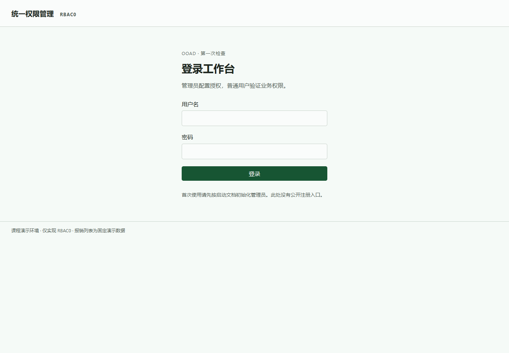

### 用户与角色授权

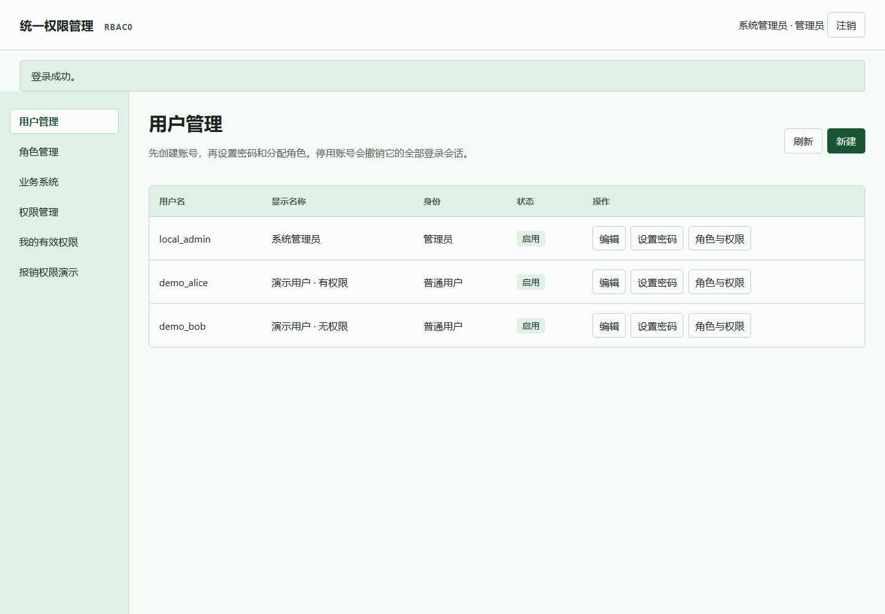

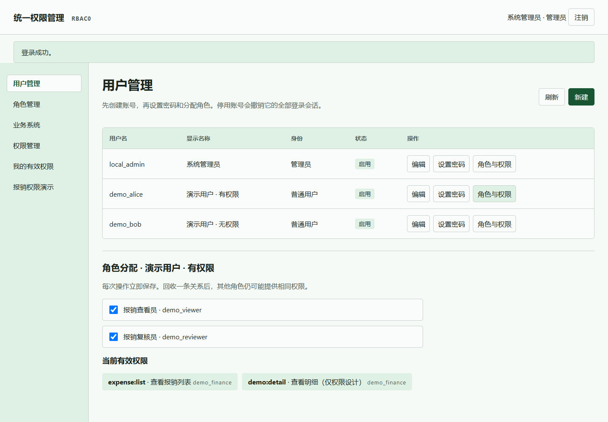

### 角色、系统、权限

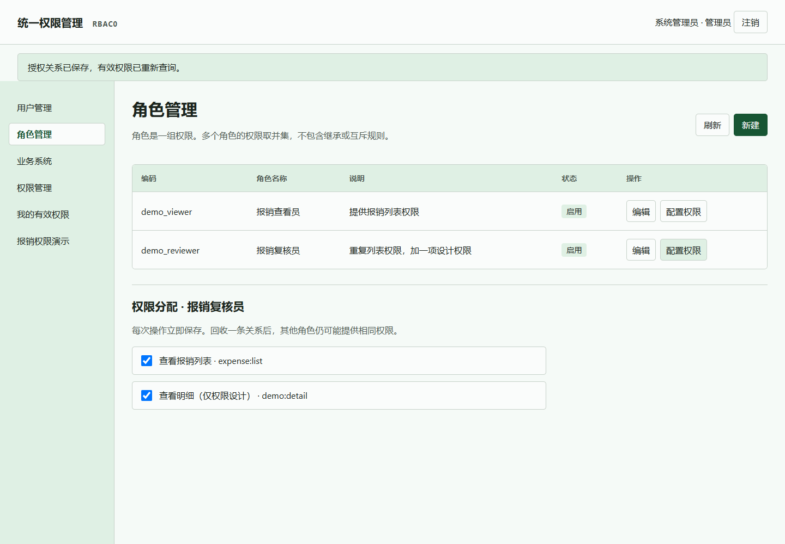

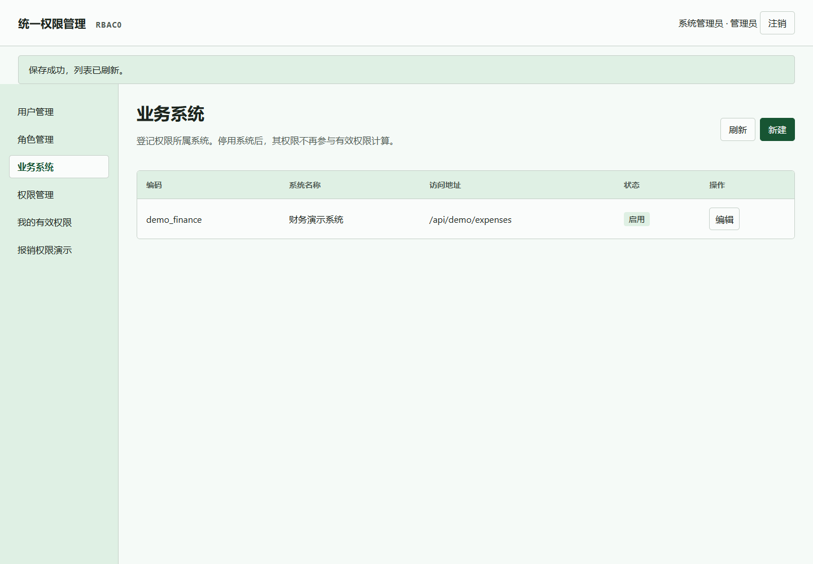

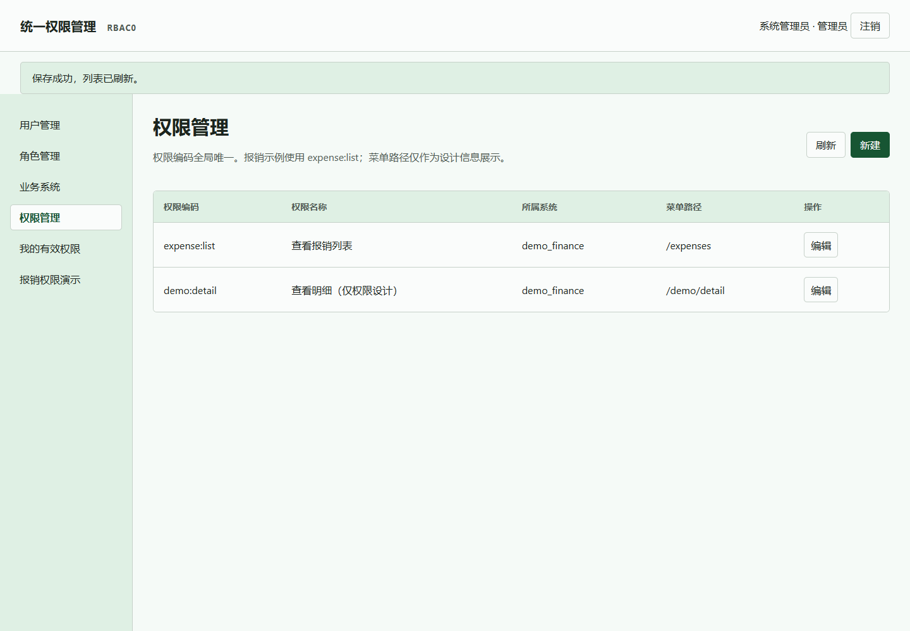

### 普通用户与三种业务结果

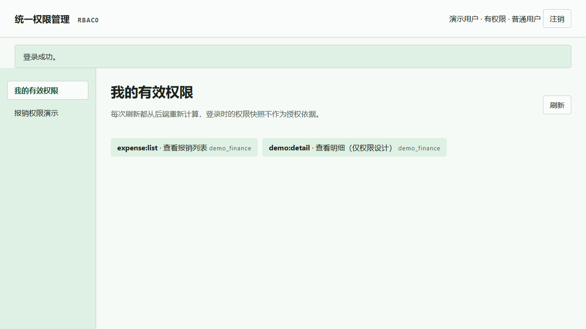

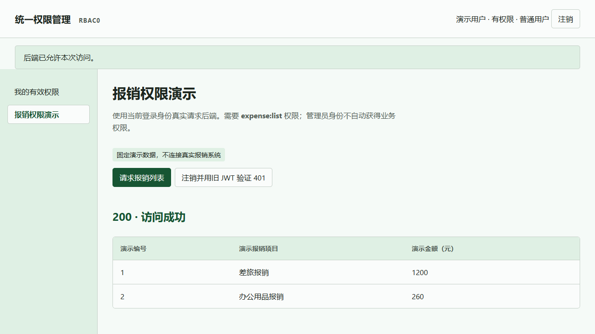

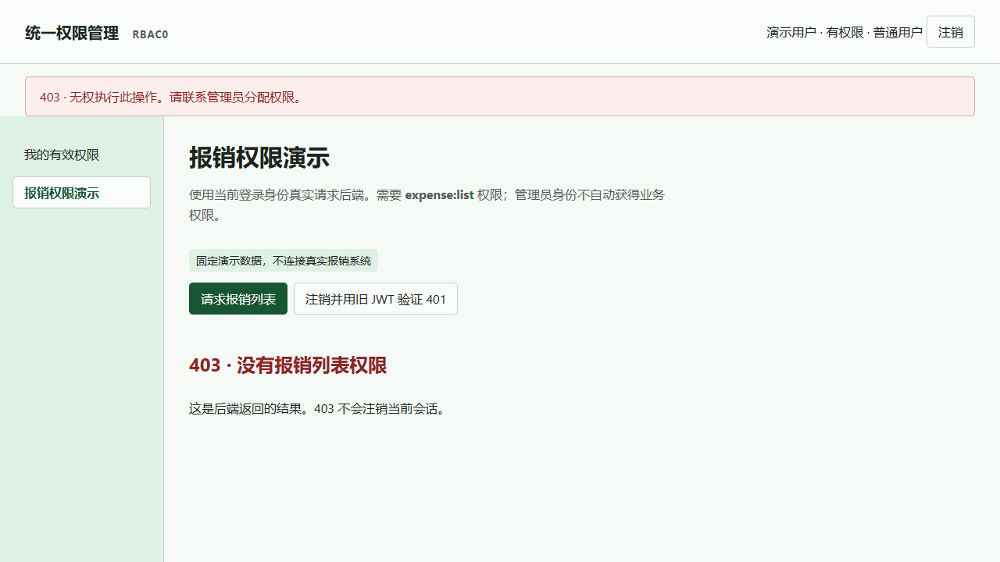

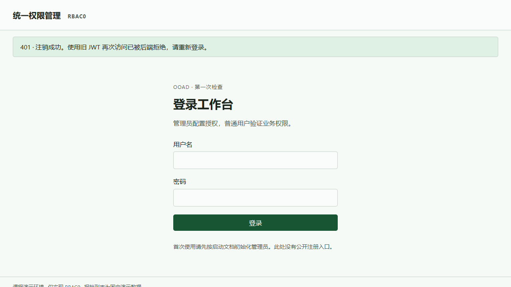

### 校验与会话失效

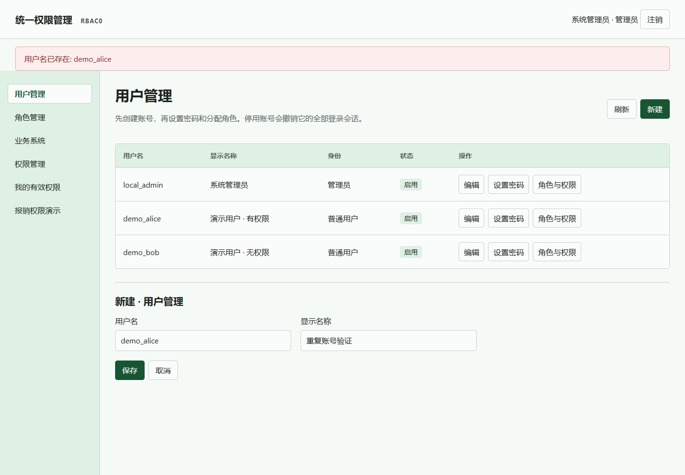

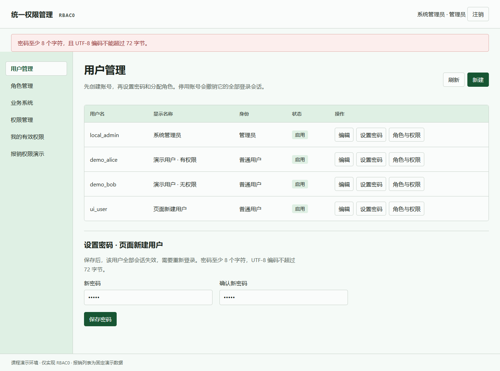

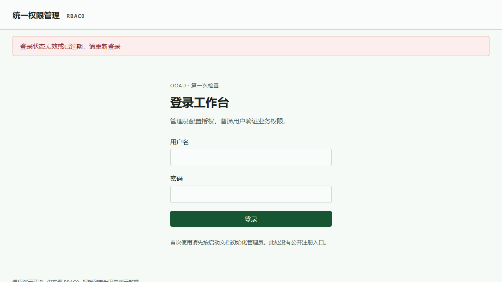

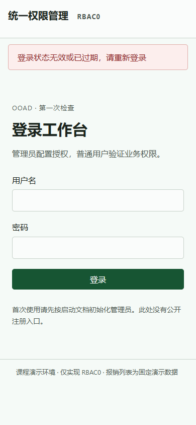

### 最终产物重启后的空列表与新建

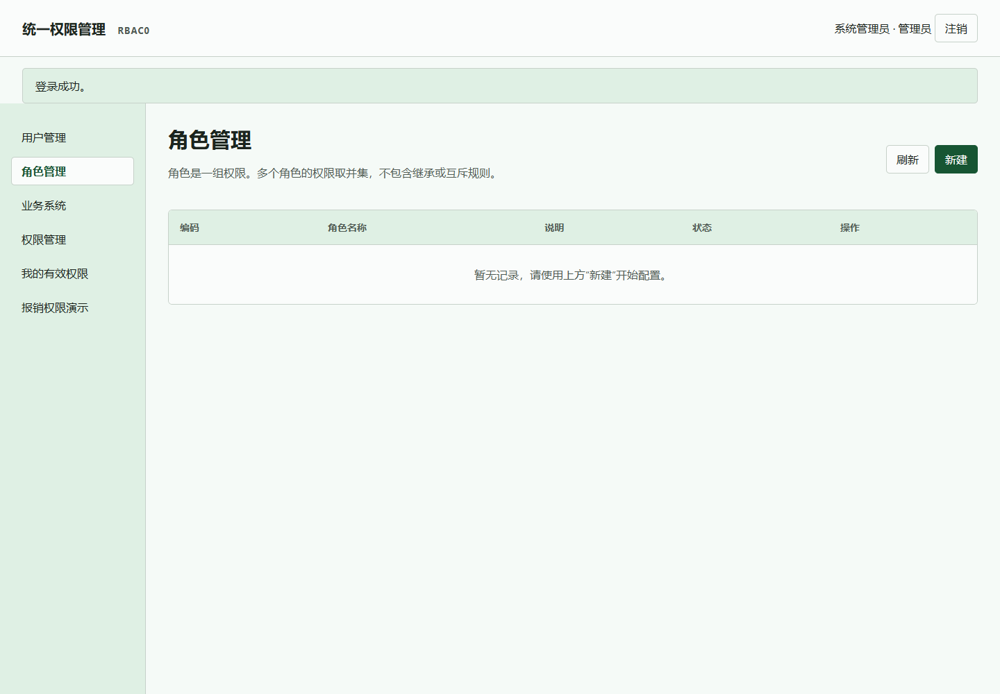

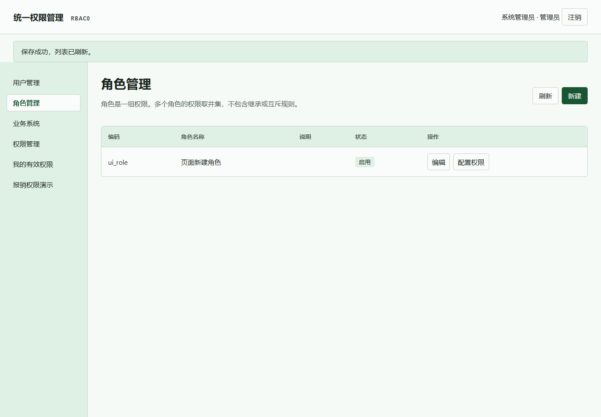

## 浏览器实测边界

已操作登录、用户新建和编辑/停用、设置密码、用户角色回收、角色权限回收、角色新建/停用、系统新建、权限新建、重复用户名、必填及短密码校验，以及双标签页 200 → 200（剩余重复授权）→ 403 → 注销后 401。用户停用触发的 401 也已实测。最后重启最终产物，验证空列表与新建后的刷新。网络异常重试和全部屏幕阅读器行为未做完整自动化验收；不以截图推断这些能力已通过测试。
