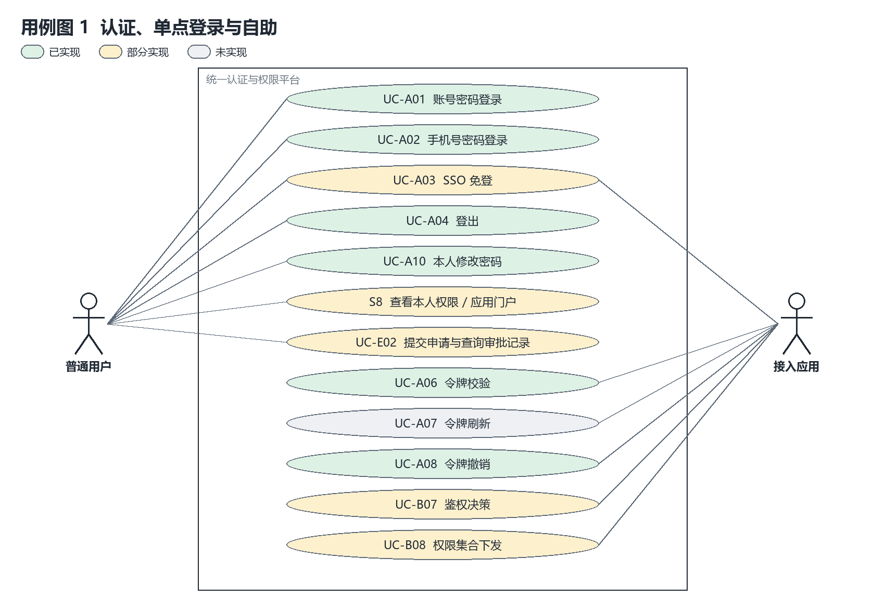
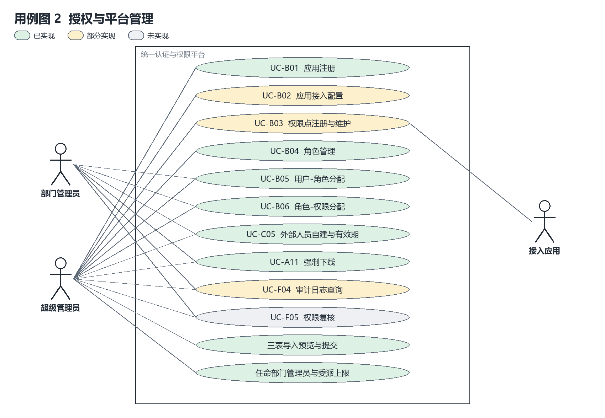
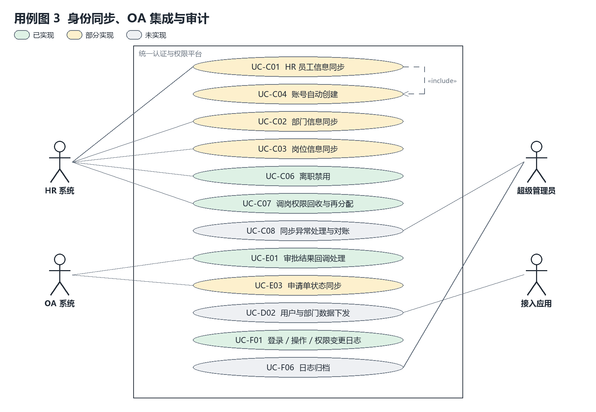
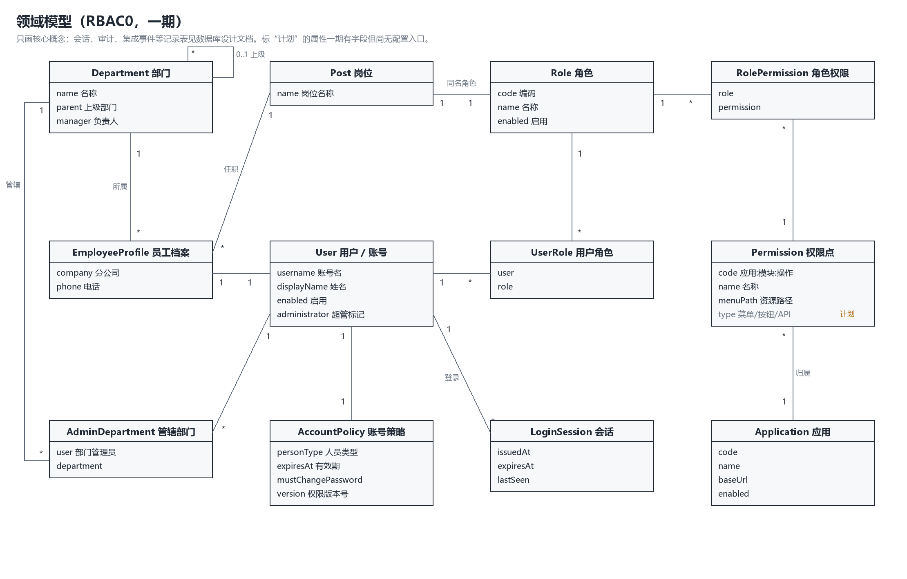
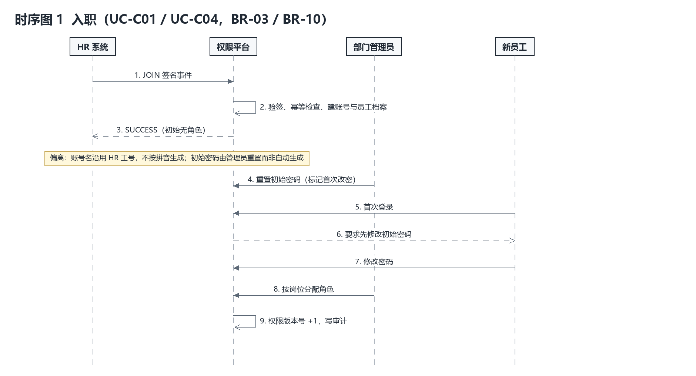
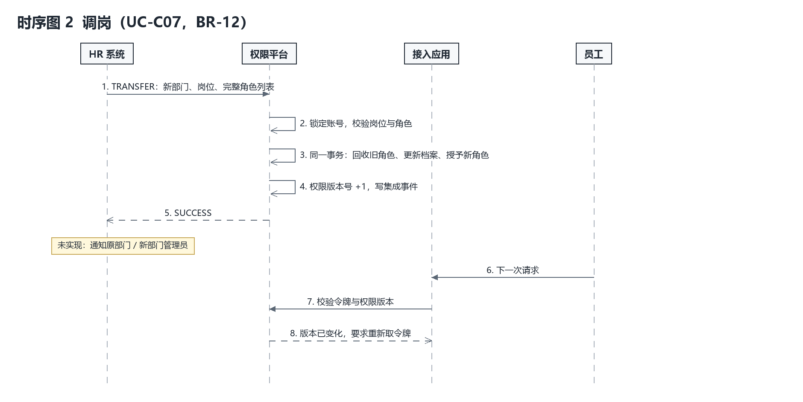
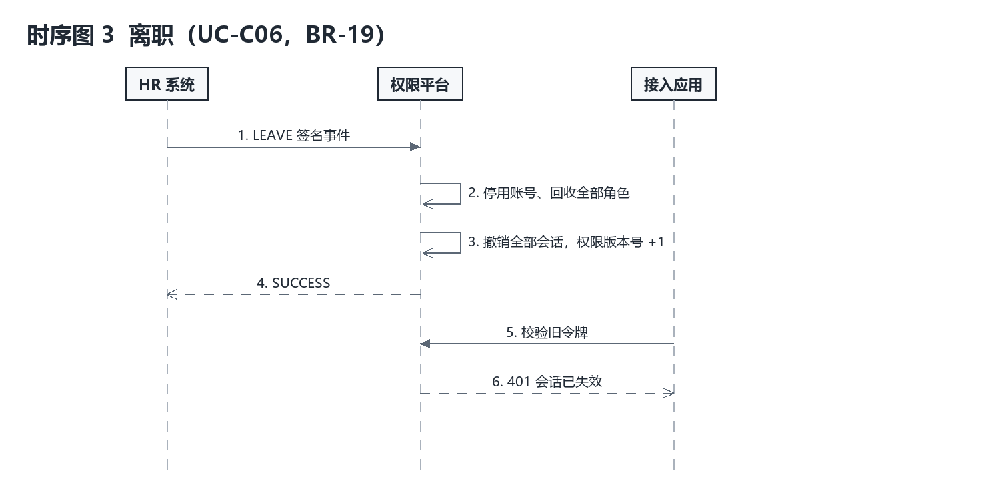
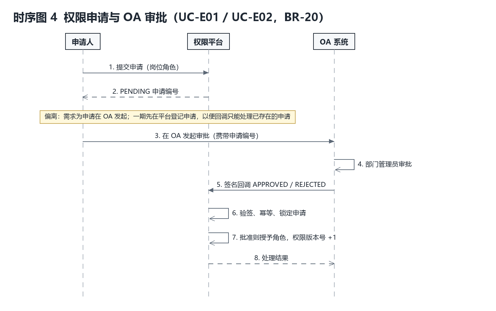
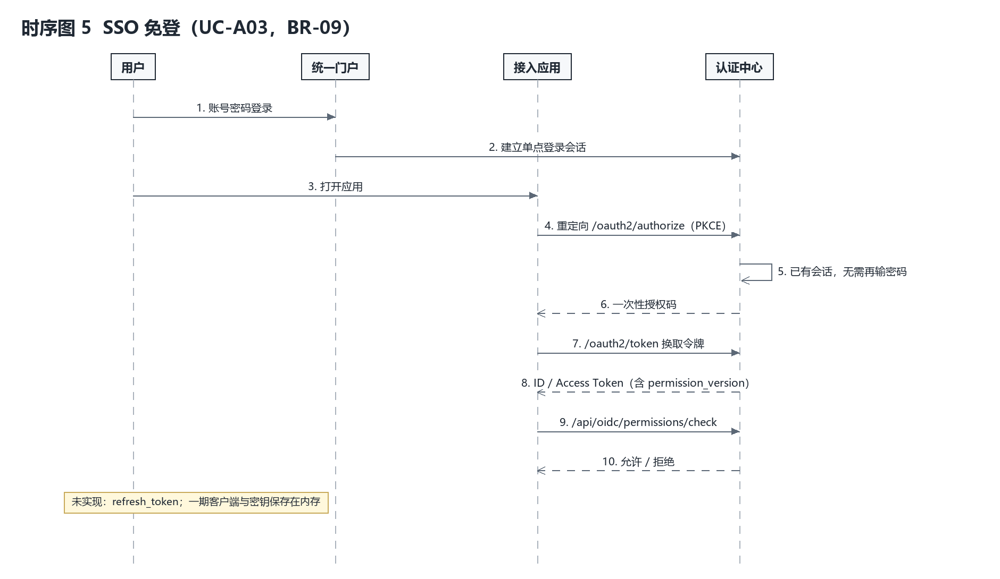

# 一期需求规格说明（Spec）

## 1 背景和目标

企业存在账号分散、反复登录、授权不可统管以及入调离操作重复的问题。目标是以统一身份为入口，以用户角色和角色权限关系计算业务权限，并让 HR 数据和 OA 审批结果驱动账号及授权变化。

本规格以《RBAC 权限管理系统 · 需求分析》V1.0（DOC-01，下称“原需求”）和三份市政公司表单为输入。用例编号 UC-xx、业务规则编号 BR-xx 沿用原需求；第 7 节的 AUTH-01 等是一期功能规格编号，每条都标出对应的 UC/BR。第 12 节列出每个用例和规则的当前状态，未完成项不视为已交付。版本：1.2；基线日期：2026-10-21。

一期范围为原需求 S1–S8；RBAC1 角色继承、RBAC2 角色约束、数据权限、ABAC、单点登出、MFA、并发登录控制、短信登录、独立移动 App 不纳入（原需求 N1–N9）。

## 2 参与者与边界

| 参与者 | 可以做什么 | 不能做什么 |
| --- | --- | --- |
| 超级管理员 | 初始化平台、维护全局目录、任命部门管理员、设置委派权限上限、导入三表 | 在前端伪装为业务用户绕过真实权限判断 |
| 部门管理员 | 管理绑定部门的普通员工、维护本部门受管岗位角色、在委派范围内授权 | 任命管理员、操作其他部门员工、修改管理员、维护共享角色 |
| 普通用户 | 登录、本人改密、查看本人权限和会话、申请岗位角色、访问获授权功能 | 请求全局管理 API、自行授权、修改他人密码 |
| HR 系统 | 发送签名的入职、调岗、离职事件 | 直接修改平台管理员、凭姓名猜测员工身份 |
| OA 系统 | 对平台已存在的申请发送签名审批结果 | 用任意回调直接创建申请或多次处理同一审批 |
| 接入应用 | 通过 OIDC 免登、校验令牌、请求鉴权决策 | 绕过平台自行授予权限 |

平台管理员身份与权限表中“系统管理员”模板严格分开（BR-14）。岗位名称“经理”不构成管理授权。部门范围采用精确绑定，不自动包含子部门，避免树形变化扩大管理权限（BR-13）。

## 3 用例模型

用例按原需求第 4.2 节分为三张图。底色表示一期当前状态：绿色已实现，黄色部分实现，灰色未实现；判定依据见第 12 节。

用例图 2 中的“三表导入预览与提交”和“任命部门管理员与委派上限”是原需求之外、为落实 UC-C01–C03 与 BR-13 增加的平台用例。

## 4 领域模型

领域模型对应原需求第 6.1 节。用户与账号一期按一对一建模；岗位与角色“语义统一、存储分离”，一个岗位对应一个同名角色（BR-05）；用户角色、角色权限都是独立关联类，为 RBAC1/RBAC2 预留演进空间（原需求 6.5）。

AccountPolicy 的 personType 区分正式员工、外部人员与临时人员，expiresAt 为有效期截止时刻（到期日次日 0 点，Asia/Shanghai）；登录和每次请求都检查有效期（UC-C05、BR-11）。Permission 的类型（菜单 / 按钮 / API）是原需求 6.2 的要求，一期尚未建模。

## 5 数据分析与映射

部门表有 111 个部门，全部上级关系可解析，形成以总公司为根的树。员工表有 10000 条，SG 用户名唯一，姓名存在重名。岗位有 54 种。分公司员工的部门用“分公司名称-部门名称”匹配部门表；总部员工使用原部门名。

权限清单包含 18 个系统、115 个模块、359 个功能。系统和模块合并单元格按前项补齐，功能和授权单元格不盲目补齐。五列角色是跨系统的业务权限模板，不是 54 个岗位的自动映射。

| 来源字段 | 目标结构 | 处理规则 |
| --- | --- | --- |
| 部门名称和上级部门 | sys_department | 名称唯一，校验缺失父节点及循环 |
| 部门经理 | manager_name 和 manager_id | 仅在所属部门唯一匹配时关联；保留未关联原文 |
| 员工用户名和姓名 | sys_user | 保留 SG 标识，导入时无密码和管理标记 |
| 分公司 部门 岗位 电话 | employee_profile 与 sys_post | 组织必须匹配；岗位角色一对一，但不自动授权 |
| 系统 模块 功能 说明 | biz_system sys_module sys_function | 按层级拆分，功能名称在模块内唯一 |
| 五类角色的操作清单 | sys_permission permission_detail permission_template | 按具体操作拆分，模板明确应用后才改变角色权限 |

发现两处英文 view，按查看规范化；一处普通员工权限为空，保留未确认且不授权。查看本人和编辑本人保留独立权限编码；平台仅管理授权，具体业务仍须检查数据归属。“全部”仅展开该功能已有的具体操作，不凭空生成删除权限。“无”表示不授予，不作为覆盖其他角色的拒绝规则。

重复导入不更新已有授权；组织岗位变化通过调岗处理。

## 6 与原需求的偏离

以下偏离是一期的明确决定，评审时应按此理解，不视为遗漏。

| 原需求 | 一期做法 | 理由 | 后续 |
| --- | --- | --- | --- |
| BR-01 账号名取姓名拼音首字母，重名加手机号后四位 | 沿用 HR 表中已唯一的 SG 工号作为账号名 | 真实表 10000 人工号无重复，而姓名有重名；用工号可避免改名和冲突转人工 | 如确认必须用拼音，需提供工号到拼音账号的稳定映射与重名规则，不直接重命名既有账号 |
| BR-03 自动生成初始密码并标记首次修改 | 导入和 HR 入职账号不设密码，由管理员重置后标记首次修改 | 避免统一默认密码；一期没有安全的初始密码分发渠道 | 增加批量生成初始密码并导出分发清单 |
| 7.5 权限申请在 OA 发起 | 申请人先在平台登记申请（PENDING），再到 OA 审批，回调只能处理已登记的申请 | 防止回调携带任意用户和角色直接授权 | 真实 OA 对接时由 OA 调用登记接口 |
| 第 11 节统一响应体与业务码 | 用 HTTP 状态码 400/401/403/404/409 加 error、message 表达错误 | 沿用第一次检查已交付的接口契约 | 统一包装需版本化迁移 |
| 6.4 令牌短有效期（建议 5 分钟） | 平台 JWT 有效期 7200 秒，但每次请求都查数据库会话和当前授权；OIDC 访问令牌 5 分钟 | 平台 API 在线校验，撤权即时生效 | 引入刷新令牌后缩短平台 JWT |

## 7 功能规格

每项说明对应需求、输入、可观察行为与验收条件；“未完成”一行列出该项尚未覆盖的部分。

### AUTH-01 登录与密码策略

对应需求：UC-A01、UC-A02、UC-A10；BR-03、BR-04、BR-17。

前置与输入：账号或唯一手机号、密码。

系统行为：认证成功返回 JWT 和身份；5 次失败锁定 5 分钟；管理员重置后须先改密；30 分钟无操作失效。

验收条件：错误密码不能登录；首次改密后旧 JWT 返回 401。

未完成：失败次数按输入原文计数，账号与手机号分开累计。

### RBAC-01 角色授权与权限并集

对应需求：UC-B04、UC-B05、UC-B06、UC-B07；BR-05、BR-06、BR-09、BR-10、BR-16。

前置与输入：管理员、用户、角色和权限编号。

系统行为：有效权限为全部启用角色权限的并集；停用应用的权限不计入；授权变化使权限版本号加一。

验收条件：两角色提供同权限，回收一个仍可访问；回收全部后同 JWT 返回 403。

未完成：鉴权决策不返回判定依据，拒绝时不记录敏感访问日志。

### SCOPE-01 部门管理范围

对应需求：UC-B05、UC-B06、UC-A11；BR-13、BR-15；原需求 3.2 管理员层级。

前置与输入：超管绑定的精确部门、委派权限。

系统行为：后端同时核对操作身份、目标员工部门、受管角色和权限上限。

验收条件：跨部门重置密码返回 403；普通用户管理 API 返回 403。

未完成：部门管理员看不到本部门员工的会话和审批记录；审计按操作人部门而非目标部门过滤。

### IMPORT-01 三表校验预览与提交

对应需求：UC-C01、UC-C02、UC-C03、UC-C04、UC-B03；BR-02、BR-07、BR-10、BR-20。

前置与输入：部门、员工、功能权限三个 XLSX。

系统行为：先预览后确认；错误阻止提交；30 分钟预览仅创建者可用；单事务提交。

验收条件：111 部门、10000 员工、54 岗位、797 权限；初始员工授权 0；重复提交 reused=true。

未完成：权限编码未按“应用:模块:操作”规范校验；权限点无类型和失效标记。

### EXT-01 外部与临时人员有效期

对应需求：UC-C05；BR-03、BR-11、BR-13。

前置与输入：管理员填写账号、姓名、人员类型（外部人员 / 临时人员）、有效期至、所属部门、岗位、所属单位、电话和初始密码。

系统行为：外部人员有效期最长 365 天，临时人员最长 90 天，不能早于今天；部门管理员只能在绑定部门内创建和续期；新账号无角色，初始密码须首次登录后修改；到期日结束后登录返回 401，已登录令牌下一次请求返回 401；14 天内到期的账号在列表中标为即将到期；续期后恢复可用并使权限版本号加一。

验收条件：超过上限或早于今天返回 400；跨部门创建返回 403；到期后旧令牌 401、登录被拒；续期后可再次登录；对正式员工续期返回 400。

未完成：到期提醒只在管理页面标出，不主动发送消息。

### ORG-01 组织岗位与目录

对应需求：UC-B01、UC-B03、UC-C02、UC-C03；BR-05、BR-16。

前置与输入：部门父节点、岗位、应用模块功能。

系统行为：部门不成环；岗位对应同名角色；模板明确应用后追加权限；岗位字段不自动授权。

验收条件：非法父节点被拒绝；应用模板不会自动增加员工角色。

未完成：部门和字典缺少完整的编辑删除页面；旧删除接口仍为物理删除。

### SESSION-01 会话与撤销

对应需求：UC-A04、UC-A08、UC-A09、UC-A11；BR-17、BR-19。

前置与输入：当前 JWT 或会话编号。

系统行为：保存数据库会话；本人可撤销；管理员可强制下线；空闲 30 分钟失效。

验收条件：注销或强制下线后旧 JWT 返回 401。

未完成：登出不写审计；会话列表只返回本人会话。

### OIDC-01 本地双客户端单点登录

对应需求：UC-A03、UC-A05、UC-A06、UC-A07、UC-D01；BR-09。

前置与输入：平台会话、client_id、redirect_uri、PKCE S256。

系统行为：两个本地客户端用授权码登录；校验 state、nonce、签名及受众；业务鉴权比对 permission_version。

验收条件：第二客户端无需再输密码；授权码二次交换返回 400；版本变化后返回 401。

未完成：刷新令牌（UC-A07）；客户端、授权和密钥持久化；在应用管理中配置回调地址（UC-B02）。

### OA-01 申请与审批联动

对应需求：UC-E01、UC-E02、UC-E03；BR-09、BR-20。

前置与输入：员工申请 roleId；OA 签名回调 approvalId、decision。

系统行为：先创建 PENDING；审批锁定记录；只批准申请内的岗位角色；申请人停用或过期时拒绝批准。

验收条件：批准授予角色；拒绝不授予；同事件重试 reused=true。

未完成：给 OA 的“查询申请人现有权限”辅助接口；部门管理员查询本部门审批记录。

### HR-01 入职调岗离职联动

对应需求：UC-C01、UC-C04、UC-C06、UC-C07；BR-01、BR-10、BR-12、BR-19、BR-20。

前置与输入：HR 签名事件 JOIN、TRANSFER、LEAVE。

系统行为：入职无密码无授权；调岗在同一事务内替换组织和完整角色集合；离职停用、撤权、撤会话。

验收条件：同编号不同内容返回 409；离职旧 JWT 返回 401；HR 不自动变更管理员。

未完成：部门 / 岗位同步接口；同步异常与对账（UC-C08）；调岗时通知原部门和新部门管理员。

### AUDIT-01 操作记录与字典

对应需求：UC-F01、UC-F02、UC-F03、UC-F04；原需求 S5。

前置与输入：操作人、事件类型；字典分类编码名称。

系统行为：记录登录及管理操作；管理范围控制查询；字典按分类编码存储；审计只追加，不提供修改删除接口。

验收条件：普通员工不能读取管理审计；分页返回 items 和 total。

未完成：权限复核（UC-F05）；12 个月留存与归档（UC-F06、BR-18）；按时间和用户查询。

### UI-01 中文交互与错误反馈

对应需求：原需求第 10 节；BR-08。

前置与输入：浏览器操作与 API 响应。

系统行为：Vue3 + TypeScript + Tailwind；必填校验；成功后刷新；401 回登录、403 保持会话并提示。

验收条件：真实页面截图展示导入、用户和登录失效；前端类型检查及构建成功。

未完成：原需求列出的 20 个页面尚未全部提供；菜单按权限点渲染未单独验证。

## 8 核心业务流程

### 8.1 入职

### 8.2 调岗

### 8.3 离职

### 8.4 权限申请与审批

### 8.5 SSO 免登

### 8.6 核心业务规则

有效权限等于用户全部启用角色所拥有、且所属应用启用的权限并集。回收一个角色时，如果另一角色仍提供同一权限，则保留该权限。没有拒绝优先、角色继承或互斥规则（BR-06）。

平台 JWT 每次请求都验证数据库会话，再查询当前权限；回收角色后同一 JWT 返回 403，注销后返回 401。OIDC 令牌使用独立签名和协议端点；本地权限检查接口还检查会话和权限版本（BR-09）。离线验证只能证明签名和有效期，不能保证即时撤权，业务应用需要在线查询或与平台约定失效策略。

导入为一个提交单元。预览不改数据库；提交时再次确认预览归属、有效期、错误数量和警告确认。员工用户名如果撞到已有非导入账号，整批回滚。已有组织岗位变化必须通过调岗处理，不覆盖现有授权。

调岗事件明确给出新部门、岗位和完整角色列表，先校验，再在同一事务内回收旧角色并设置新角色（BR-12）。离职停用账号、回收角色、撤销会话。平台管理员不能被 HR 自动停用，必须先人工解除管理身份。

OA 审批结果必须关联已有申请。拒绝不授予角色；批准后为申请人添加申请角色。相同事件编号与相同内容重复提交返回已处理；同编号不同内容拒绝（BR-20）。已处理审批不能通过另一个事件编号改写结果。

## 9 功能分解与实现方法

本阶段按功能组织用例：认证、账号维护、目录配置、授权、有效权限查询、导入、审批回调和员工同步。控制器负责 HTTP 输入和身份入口，服务负责规则与事务，Repository 或参数化 SQL 负责存取。不以设计模式数量作为目标。

导入功能分为读取 XLSX、校验计划、预览、事务提交。认证分为密码验证、账号策略、会话签发与鉴权。OA/HR 共用签名和事件幂等入口，分别执行审批和员工生命周期规则。独立保存原始目录与当前授权，避免每次同步重置人工授权。

## 10 验收用例与安全约束

| 用例 | 预期效果 | 证据 |
| --- | --- | --- |
| 三表原始数据导入和重复提交 | 10000 员工 797 权限 初始授权 0，重复不新增 | ActualWorkbookImportTests 与 actual-import.txt |
| 部门管理员跨部门重置密码 | 403，不修改目标账号 | PhaseOneIntegrationTests |
| 首次密码重置 | 旧会话 401，新登录须先改密 | PhaseOneIntegrationTests 与 HTTP 验收 |
| 普通用户越权访问管理 API | 403 | AdminAccessIntegrationTests |
| 多角色并集与回收 | 重叠权限仍保留，全部来源回收后 403 | RBAC 与管理接口测试 |
| OIDC 两客户端登录 | 验签成功，第二客户端不再输入密码 | HTTP 验收和实际浏览器截图 |
| OA 审批与 HR 入调离 | 幂等，拒绝不授权，离职旧 JWT 401 | HTTP 验收和集成测试 |
| 前端输入与登录失效 | 必填校验，401 返回登录，403 保留会话并提示 | 浏览器运行截图 |

上传大小、压缩包条目限制、XML 外部实体禁用及公式拒绝用于约束不可信表单。密码采用 BCrypt 摘要，密钥通过环境变量注入。截图使用虚构人员。导入警告必须确认；401 与 403 使用不同提示。

## 11 需求追踪矩阵

| Spec 编号 | 原需求 | 界面与接口 | 数据结构 |
| --- | --- | --- | --- |
| AUTH-01 | UC-A01 A02 A10；BR-03 04 17 | 登录、个人中心；/api/auth/login；/api/platform/self/password | sys_user、account_policy、login_attempt |
| RBAC-01 | UC-B04 B05 B06 B07；BR-05 06 09 10 16 | 用户、角色、我的权限、报销演示；/api/users/{userId}/roles/{roleId}；/api/demo/expenses | sys_user_role、sys_role_permission |
| SCOPE-01 | UC-B05 B06 A11；BR-13 15 | 用户、角色；/api/platform/administrators/{id}；/api/platform/organization | admin_department、managed_role、department_permission |
| IMPORT-01 | UC-C01 C02 C03 C04 B03；BR-02 07 10 20 | 三表导入；/api/company/imports/preview；/api/company/imports/commit | company_import_batch、employee_profile |
| EXT-01 | UC-C05；BR-03 11 13 | 外部与临时人员；/api/platform/external-users；/api/platform/external-users/{id}/expiry | account_policy、employee_profile、sys_user |
| ORG-01 | UC-B01 B03 C02 C03；BR-05 16 | 部门、岗位、功能目录；/api/platform/organization/departments；/api/company/posts/{id}/template | sys_department、sys_post、sys_module、sys_function、permission_template |
| SESSION-01 | UC-A04 A08 A09 A11；BR-17 19 | 在线会话、用户；/api/auth/logout；/api/platform/sessions | sys_login_session、session_activity |
| OIDC-01 | UC-A03 A05 A06 A07 D01；BR-09 | 应用门户、OA 与 HR 本地客户端；/api/platform/self/sso；/oauth2/authorize；/oauth2/token | 平台会话；OIDC 授权记录保存在内存 |
| OA-01 | UC-E01 E02 E03；BR-09 20 | 权限申请、审批记录；/api/platform/self/applications；/api/integration/oa | approval_record、integration_event、sys_user_role |
| HR-01 | UC-C01 C04 C06 C07；BR-01 10 12 19 20 | 同步记录、用户；/api/integration/hr | employee_profile、integration_event、sys_user_role |
| AUDIT-01 | UC-F01 F02 F03 F04 | 操作日志、登录日志、字典；/api/platform/audit；/api/platform/dictionary | audit_event、data_dictionary |
| UI-01 | 第 10 节；BR-08 | /ui/index.html；复用以上业务 API | 由业务 API 访问数据库 |

## 12 需求覆盖与当前状态

统计：原需求 41 个用例中已实现 21 个、部分实现 13 个、未实现 7 个；20 条业务规则中已实现 13 条、部分实现 5 条、未实现 2 条。状态按代码与自动化测试判定，前端未逐页点击验证。

### 12.1 用例

| 编号 | 用例 | 状态 | 说明 |
| --- | --- | --- | --- |
| UC-A01 | 账号密码登录 | 已实现 | 统一错误提示，失败记录日志，达阈值锁定 |
| UC-A02 | 手机号密码登录 | 已实现 | 手机号重复时不能用它登录 |
| UC-A03 | SSO 免登 | 部分实现 | 仅两个本地演示客户端 |
| UC-A04 | 登出 | 已实现 | 登出后旧 JWT 返回 401；登出未写审计 |
| UC-A05 | 令牌签发 | 已实现 | 平台 JWT 与 OIDC 令牌 |
| UC-A06 | 令牌校验 | 已实现 | 校验签名、受众、会话与权限版本 |
| UC-A07 | 令牌刷新 | 未实现 | 无 refresh_token |
| UC-A08 | 令牌撤销 | 已实现 | 会话撤销、强制下线、OIDC revoke 端点 |
| UC-A09 | 会话超时与续期 | 已实现 | 30 分钟无操作失效，请求自动续期 |
| UC-A10 | 本人修改密码 | 已实现 | 改密后旧会话失效 |
| UC-A11 | 强制下线 | 已实现 | 部门管理员仅限本部门普通员工 |
| UC-B01 | 应用注册 | 已实现 | /api/systems |
| UC-B02 | 应用接入配置 | 部分实现 | OIDC 客户端与回调写在配置代码中 |
| UC-B03 | 权限点注册与维护 | 部分实现 | 缺类型、失效标记和编码规范校验 |
| UC-B04 | 角色管理 | 已实现 | 有引用时拒绝删除 |
| UC-B05 | 用户-角色分配 | 已实现 | 含部门范围校验 |
| UC-B06 | 角色-权限分配 | 已实现 | 部门管理员受委派上限约束 |
| UC-B07 | 鉴权决策 | 部分实现 | 不返回判定依据，拒绝不记敏感访问日志 |
| UC-B08 | 权限集合下发 | 部分实现 | 平台 API 可查；OIDC userinfo 不含权限 |
| UC-B09 | 权限变更记录 | 已实现 | 授权和回收均写审计 |
| UC-C01 | HR 员工信息同步 | 部分实现 | 单条事件与三表导入；无全量 / 增量同步 |
| UC-C02 | 部门信息同步 | 部分实现 | 仅三表导入 |
| UC-C03 | 岗位信息同步 | 部分实现 | 仅三表导入 |
| UC-C04 | 账号自动创建 | 部分实现 | 沿用工号，无初始密码（见第 6 节） |
| UC-C05 | 外部人员自建与有效期 | 已实现 | 外部人员 ≤ 365 天、临时人员 ≤ 90 天；到期失效；列表提醒与续期 |
| UC-C06 | 离职禁用 | 已实现 | 停用、回收角色、撤销会话、版本加一 |
| UC-C07 | 调岗权限回收与再分配 | 已实现 | 单事务完成；不通知部门管理员 |
| UC-C08 | 同步异常处理与对账 | 未实现 | 仅有集成事件列表 |
| UC-D01 | 应用协议接入 | 部分实现 | 仅 OIDC；协议适配层与能力对照表未写 |
| UC-D02 | 用户与部门数据下发 | 未实现 | 无面向接入应用的接口 |
| UC-D03 | 应用接入验收 | 未实现 | 无验收清单 |
| UC-D04 | 无法改造系统的兼容处理 | 未实现 | 未涉及 |
| UC-E01 | 审批结果回调处理 | 已实现 | 签名、幂等、驳回不执行、停用拒绝 |
| UC-E02 | 审批记录查询 | 部分实现 | 本人可查；部门管理员不能查本部门 |
| UC-E03 | 申请单状态同步 | 部分实现 | 仅 PENDING / APPROVED / REJECTED |
| UC-F01 | 登录日志记录 | 已实现 | 成功与失败均记录 |
| UC-F02 | 操作日志记录 | 已实现 | 写请求自动留痕 |
| UC-F03 | 权限变更日志记录 | 已实现 | — |
| UC-F04 | 审计日志查询 | 部分实现 | 仅按类型前缀过滤；部门范围按操作人 |
| UC-F05 | 权限复核 | 未实现 | — |
| UC-F06 | 日志归档 | 未实现 | — |

### 12.2 业务规则

| 编号 | 规则 | 状态 | 说明 |
| --- | --- | --- | --- |
| BR-01 | 账号生成规则 | 未实现 | 一期沿用工号，见第 6 节 |
| BR-02 | 账号名唯一 | 部分实现 | 有唯一约束；逻辑删除未改写账号名 |
| BR-03 | 密码存储与初始化 | 部分实现 | BCrypt；重置后首次改密；无自动初始密码 |
| BR-04 | 强密码策略 | 已实现 | 至少 8 位、三类字符 |
| BR-05 | 角色与岗位 | 已实现 | 岗位创建同名角色 |
| BR-06 | RBAC0 边界 | 已实现 | 无继承与互斥 |
| BR-07 | 权限点来源与编码 | 部分实现 | 清单导入；编码规范未校验 |
| BR-08 | 前后端双重校验 | 部分实现 | 后端全部校验；前端菜单渲染未验证 |
| BR-09 | 权限即时生效 | 已实现 | 版本号与数据库实时查询 |
| BR-10 | 初始无权限 | 已实现 | 真实导入后授权数 0 |
| BR-11 | 外部人员有效期 | 已实现 | 必填有效期，到期自动失效，14 天内到期提醒并可续期；提醒不主动推送 |
| BR-12 | 调岗处理 | 已实现 | 同一事务 |
| BR-13 | 部门管理员管辖边界 | 已实现 | 精确部门绑定 |
| BR-14 | 系统管理员边界 | 已实现 | 模板与平台身份分离 |
| BR-15 | 内置数据保护 | 部分实现 | 新接口已保护；旧删除接口未验证 |
| BR-16 | 引用校验 | 已实现 | 角色、应用、权限点 |
| BR-17 | 会话超时 | 已实现 | 30 分钟 |
| BR-18 | 日志留存 | 未实现 | 无留存与归档 |
| BR-19 | 会话失效范围 | 已实现 | 停用、离职、改密、版本变更 |
| BR-20 | 幂等性 | 已实现 | 回调、HR 事件、导入 |

### 12.3 一期待完成清单

- 令牌刷新与 OIDC 客户端持久化，在应用管理中配置回调地址（UC-A07、UC-B02、UC-D01）。
- 权限点类型（菜单 / 按钮 / API）、失效标记与编码规范校验（UC-B03、BR-07）。
- 部门管理员查看本部门会话、审批记录与审计，审计按目标部门过滤（UC-A11、UC-E02、UC-F04）。
- 用户与部门数据下发接口，userinfo 携带权限集合，鉴权返回判定依据并记录拒绝（UC-D02、UC-B07、UC-B08）。
- HR 部门 / 岗位同步、同步异常与对账，调岗通知部门管理员（UC-C02、C03、C07、C08）。
- 导入员工批量生成初始密码并分发（BR-03）。
- 权限复核、审计按时间与用户查询、12 个月归档（UC-F04–F06、BR-18）。
- 协议适配层定义与能力对照表、应用接入验收清单、不可改造系统兼容方案（UC-D01、D03、D04）。
- 界面补齐原需求的 20 个页面，菜单按权限点渲染（第 10 节、BR-08）。
- MySQL 8 建表脚本实测、多实例与性能指标验收（原需求第 9、13 节）。
