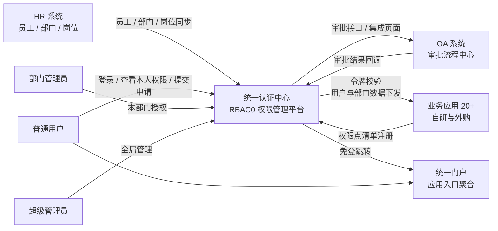
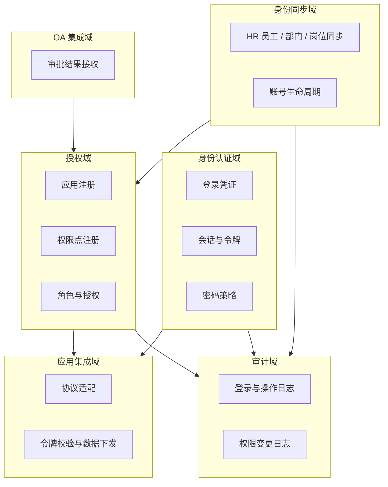
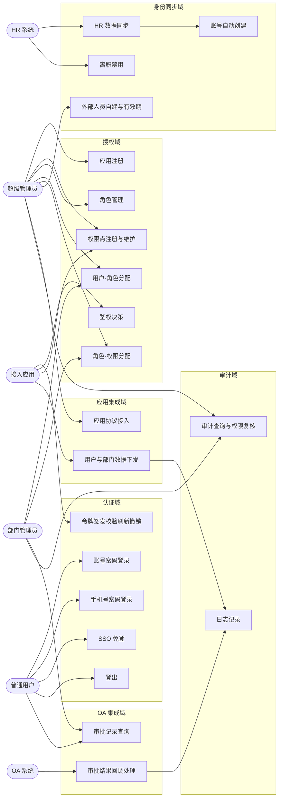
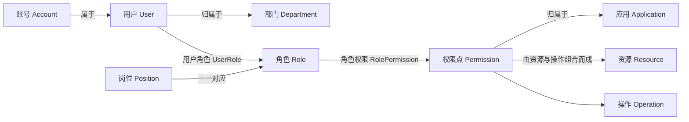
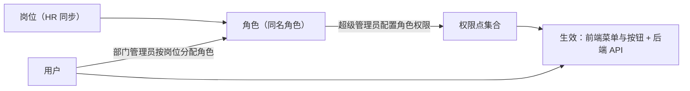
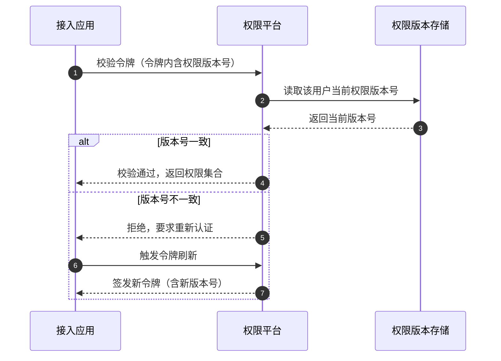
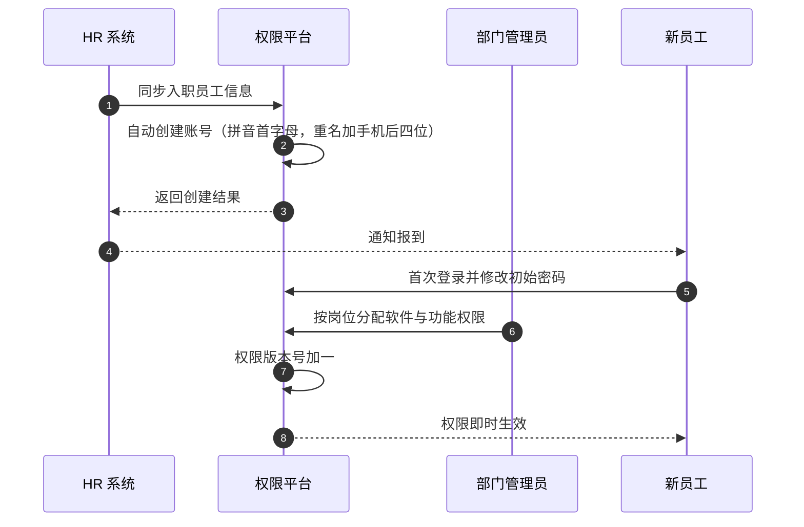
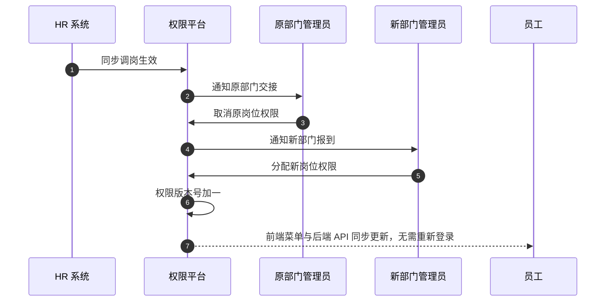
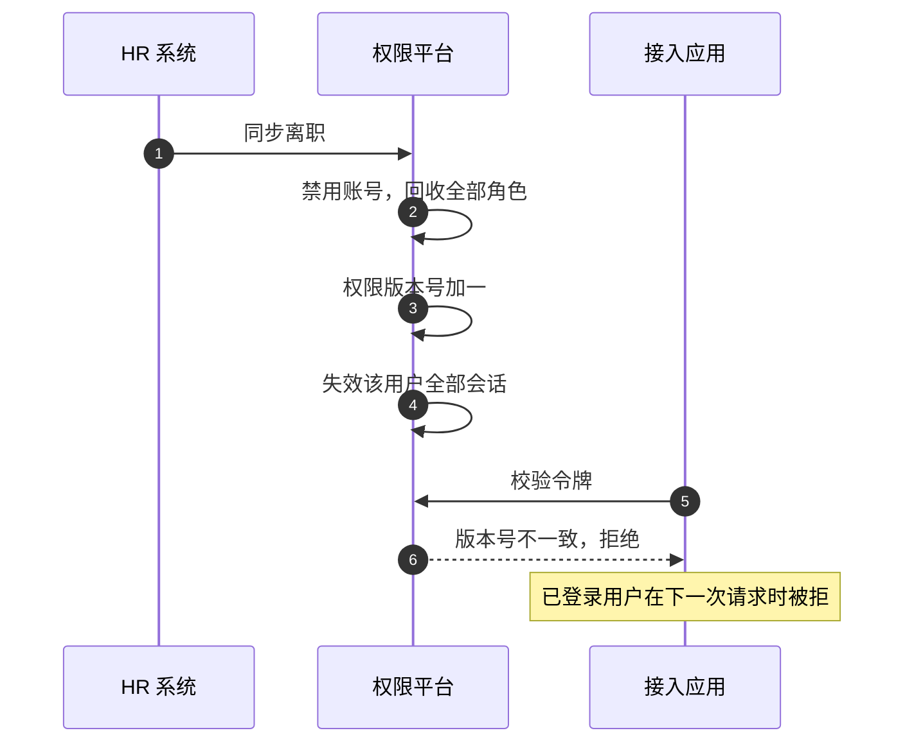
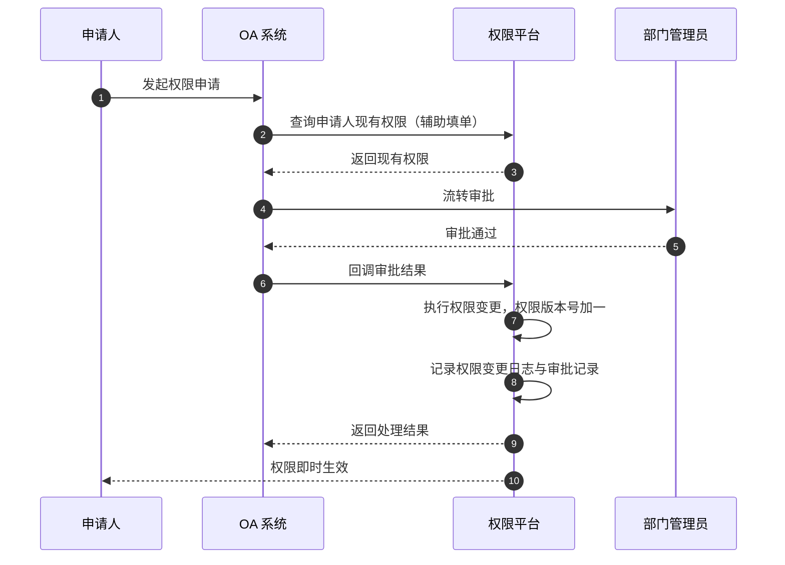

# RBAC 权限管理系统 · 需求分析

| 项目 | 内容 |
| --- | --- |
| 文档编号 | DOC-01 |
| 版本 | V1.0 |
| 日期 | 2026-10-15 |
| 状态 | 已整理，含待确认事项 |
| 依据 | 《RBAC 权限管理系统全貌》（需求沟通、录音转写与澄清汇总） |
| 后续文档 | DOC-02 界面原型、DOC-03 API 设计、DOC-04 数据库设计 |

---

## 1 引言

### 1.1 编写目的

本文档定义"统一认证中心 + 单点登录 + RBAC0 统一权限管理平台"的业务范围、角色边界、功能需求、业务规则与非功能需求，作为后续界面原型设计、API 设计与数据库设计的唯一输入。

### 1.2 项目背景

企业员工规模一万以上，在用的软件系统二十多个，覆盖十几家开发商。每名员工日常使用八到十个以上系统。

当前的问题集中在四处：

1. **登录割裂**：各软件独立登录，账号密码规则不统一，员工需要记住多套凭证。
2. **用户管理分散**：各软件开发商各自维护用户，同一名员工在不同系统中的账号状态互不一致。
3. **权限不可统管**：权限配置散落在各系统内部，集团层面既看不到全貌，也无法统一调整。
4. **运维成本高**：入职、调岗、离职需要在每个系统中分别处理。

### 1.3 读者对象

信息中心管理人员、各部门管理员、参与评审的业务方代表、后续负责实现与测试的开发人员。

### 1.4 术语与缩略语

| 术语 | 说明 |
| --- | --- |
| 用户 User | 自然人实体，含正式员工、外部人员、临时人员、劳务工 |
| 账号 Account | 登录凭证，支持"账号 + 密码"与"手机号 + 密码"两种登录 |
| 岗位 Position | 来自 HR 的主数据，代表公司岗位 |
| 角色 Role | 权限系统中的权限载体，与岗位一一对应 |
| 应用 Application | 接入统一认证与权限管理的业务软件，约 20+ 个 |
| 权限点 Permission | 应用内可授权的最小单元，包括菜单、按钮、API |
| 用户角色 UserRole | 用户与角色的分配关系 |
| 角色权限 RolePermission | 角色与权限点的分配关系 |
| 会话 Session | 用户登录后的会话状态 |
| 令牌 Token | SSO 登录后颁发的访问凭证 |
| 权限版本号 Permission Version | 用于实现权限变更即时生效的版本标识 |
| RBAC0 | 基础角色访问控制模型，仅含用户-角色、角色-权限两组关系 |
| RBAC1 / RBAC2 | 含角色继承 / 含角色约束的扩展模型，一期不纳入 |
| SSO | 单点登录 |
| OIDC | 基于 OAuth2 的身份认证协议，一期唯一落地的 SSO 协议 |
| JIT Provisioning | 首次访问时即时创建用户 |

### 1.5 参考资料

- 《RBAC 权限管理系统全貌》
- 《00-需求梳理与待确认清单》

---

## 2 项目概述

### 2.1 建设目标

1. **统一认证**：员工一次登录后访问各接入软件免登。
2. **统一权限管理**：集中管理集团所有软件的用户、角色与权限，明确控制"用户能看什么、能干什么"。
3. **集中运维**：以 HR 员工信息驱动账号与权限生命周期，入职、调岗、离职在平台内一次处理完成。
4. **可审计**：登录、登出、授权、权限变更、管理操作与敏感访问全部留痕。

### 2.2 一期建设范围

| 编号 | 范围 | 说明 |
| --- | --- | --- |
| S1 | 统一认证中心 | 账号密码、手机号密码两种登录方式 |
| S2 | SSO 免登 | 一次登录后访问各接入软件免登 |
| S3 | RBAC0 权限管理 | 用户、角色、权限点；用户-角色分配；角色-权限分配 |
| S4 | 应用与权限点注册 | 应用注册、各应用权限点清单的统一注册与维护 |
| S5 | 基础审计 | 登录、登出、授权、权限变更、管理操作 |
| S6 | OA 集成 | 权限申请审批走 OA，审批通过后回调平台执行变更 |
| S7 | HR 集成 | 员工信息、部门、岗位同步 |
| S8 | 统一门户 | 应用入口聚合，用户自助查看本人权限 |

### 2.3 一期不纳入范围

| 编号 | 不纳入项 | 说明 |
| --- | --- | --- |
| N1 | RBAC1 | 角色继承 |
| N2 | RBAC2 | 角色互斥、基数约束、职责分离 |
| N3 | 数据权限 | 行级、字段级权限 |
| N4 | ABAC | 复杂动态策略 |
| N5 | 单点登出 | 全平台统一注销 |
| N6 | MFA | 多因素认证 |
| N7 | 并发登录控制 | 同一账号多端登录限制 |
| N8 | 短信验证码登录 | 一期不做 |
| N9 | 移动端独立 App | 一期按移动端浏览器适配 |

**关于"部门管理员只管理本部门"与 N3 的说明。** 这两者并不矛盾，需要在实现上区分：N3 所排除的是面向全部业务实体的通用数据权限框架（任意资源、任意行级与字段级过滤、可由管理员自由配置的数据范围策略）。而部门管理员的管辖范围是**平台自身的一条管理边界**，由"管理员-部门绑定关系"这一显式配置决定，仅作用于平台的管理后台接口。因此本平台的管理边界不属于 N3 的排除范围，一期必须实现。

### 2.4 系统上下文

---

## 3 干系人与角色

### 3.1 人员类型

平台承载四类人员，来源与生命周期各不相同。

| 类型 | 来源 | 规模 | 权限特征 |
| --- | --- | --- | --- |
| 正式员工 | HR 系统同步 | 主体 | 权限随岗位与部门变化 |
| 劳务工 | HR 系统同步 | 约 1—2 千人 | 权限高度同质，同一批人共用同一套角色 |
| 外部人员 | 平台自建 | 不定 | 外包、兼职、供应商、客户等，必须设置权限有效期 |
| 临时人员 | 平台自建 | 少量 | 一次性或短期权限，同样必须设置有效期 |

### 3.2 管理员层级

| 角色 | 管辖范围 | 核心职责 |
| --- | --- | --- |
| 超级管理员（信息中心） | 全集团 | 应用注册、权限点注册、全局角色与权限管理、审计查询 |
| 部门管理员 | 本部门 | 本部门用户维护、按岗位为本部门员工分配角色与权限 |
| 普通用户 | 本人 | 查看本人权限、发起权限申请 |
| 系统管理员 | 无（不可进入管理后台） | 仅使用业务软件，不能管理权限 |

补充要求：**权限系统自身的管理权限同样受控**，即"谁管理管理员"必须有明确规则。一期规则为：超级管理员角色的成员由超级管理员维护，部门管理员由超级管理员任命并绑定可管辖部门，部门管理员无权任命或调整其他部门管理员。

### 3.3 权限矩阵

| 功能域 | 超级管理员 | 部门管理员 | 普通用户 | 系统管理员 |
| --- | --- | --- | --- | --- |
| 进入管理后台 | 是 | 是 | 否 | 否 |
| 用户管理 | 全部 | 仅本部门：查询、修改、分配角色 | 否 | 否 |
| 角色管理 | 全部 | 仅本部门人员的角色分配 | 否 | 否 |
| 应用注册 | 全部 | 否 | 否 | 否 |
| 权限点注册与维护 | 全部 | 否 | 否 | 否 |
| 角色-权限分配 | 全部 | 仅涉及本部门的角色 | 否 | 否 |
| 部门 / 岗位 / 字典维护 | 全部 | 本部门只读 | 否 | 否 |
| 会话管理 | 全部 | 本部门用户 | 仅本人 | 仅本人 |
| 审计日志查询 | 全部 | 仅本部门 | 否 | 否 |
| 查看本人权限 | 是 | 是 | 是 | 是 |
| 发起权限申请 | 是 | 是 | 是 | 是 |

---

## 4 领域与用例总览

### 4.1 限界上下文

### 4.2 用例总览

---

## 5 功能需求

### 5.1 认证域

| 编号 | 用例名称 | 主要参与者 | 优先级 |
| --- | --- | --- | --- |
| UC-A01 | 账号密码登录 | 普通用户 | 高 |
| UC-A02 | 手机号密码登录 | 普通用户 | 高 |
| UC-A03 | SSO 免登 | 普通用户、接入应用 | 高 |
| UC-A04 | 登出 | 普通用户 | 高 |
| UC-A05 | 令牌签发 | 认证中心 | 高 |
| UC-A06 | 令牌校验 | 接入应用 | 高 |
| UC-A07 | 令牌刷新 | 接入应用 | 高 |
| UC-A08 | 令牌撤销 | 认证中心、超级管理员 | 中 |
| UC-A09 | 会话超时与续期 | 认证中心 | 高 |
| UC-A10 | 本人修改密码 | 普通用户 | 高 |
| UC-A11 | 强制下线 | 超级管理员、部门管理员 | 中 |

#### 用例描述 UC-A01 · 账号密码登录

| 项目 | 内容 |
| --- | --- |
| 参与者 | 普通用户 |
| 前置条件 | 账号已由 HR 同步或由管理员创建，且状态为启用 |
| 触发条件 | 用户在登录页提交账号与密码 |
| 基本流程 | 1. 用户输入账号与密码。 2. 系统校验参数格式。 3. 系统按账号查询账号记录并比对密码哈希。 4. 校验账号状态、账号有效期。 5. 生成会话与令牌，写入权限版本号。 6. 记录登录日志。 7. 返回令牌并跳转至同意门户。 |
| 备选流程 | 3a. 账号不存在或密码错误：返回统一错误提示，不区分具体原因，记录失败登录日志。 4a. 账号已禁用：提示账号已停用。 4b. 账号已过期：提示凭证已过期，引导联系管理员。 4c. 连续失败达阈值：锁定账号一段时间。 |
| 后置条件 | 会话建立，登录日志落库 |
| 相关规则 | BR-01、BR-02、BR-03、BR-04、BR-17 |

#### 用例描述 UC-A03 · SSO 免登

| 项目 | 内容 |
| --- | --- |
| 参与者 | 普通用户、接入应用、认证中心 |
| 前置条件 | 用户在门户或任一接入应用已完成登录，会话有效；接入应用已完成注册并配置回调地址 |
| 触发条件 | 用户从门户或既有会话中打开另一个接入应用 |
| 基本流程 | 1. 用户访问接入应用。 2. 应用检测到无本地会话，重定向至认证中心授权端点。 3. 认证中心校验既有会话，无需再次输入凭证。 4. 认证中心签发一次性授权码并重定向回应用。 5. 应用以授权码换取令牌。 6. 应用校验令牌并获取用户与权限信息。 7. 用户免登进入应用。 |
| 备选流程 | 3a. 既有会话已超时：跳转登录页重新认证。 4a. 应用未注册或回调地址不匹配：拒绝并记录安全日志。 6a. 权限版本号不一致：拒绝访问并要求重新登录。 |
| 后置条件 | 应用侧建立本地会话，免登成功 |
| 相关规则 | BR-09、BR-19 |

### 5.2 授权域

| 编号 | 用例名称 | 主要参与者 | 优先级 |
| --- | --- | --- | --- |
| UC-B01 | 应用注册 | 超级管理员 | 高 |
| UC-B02 | 应用接入配置 | 超级管理员 | 高 |
| UC-B03 | 权限点注册与维护 | 超级管理员、接入应用 | 高 |
| UC-B04 | 角色管理 | 超级管理员 | 高 |
| UC-B05 | 用户-角色分配 | 部门管理员、超级管理员 | 高 |
| UC-B06 | 角色-权限分配 | 超级管理员、部门管理员 | 高 |
| UC-B07 | 鉴权决策 | 接入应用 | 高 |
| UC-B08 | 权限集合下发 | 接入应用 | 高 |
| UC-B09 | 权限变更记录 | 系统 | 高 |

#### 用例描述 UC-B03 · 权限点注册与维护

| 项目 | 内容 |
| --- | --- |
| 参与者 | 接入应用（批量导入）、超级管理员（手工维护） |
| 前置条件 | 所属应用已注册 |
| 触发条件 | 新系统接入，或既有系统升级新增功能 |
| 基本流程 | 1. 应用按约定清单格式提供权限点定义。 2. 超级管理员导入或逐条录入权限点。 3. 系统校验权限点编码符合命名规范、在应用内唯一。 4. 系统校验权限点类型（菜单 / 按钮 / API）与资源、操作的组合。 5. 保存并标记版本。 6. 已删除功能对应的权限点标记为失效，而非物理删除。 |
| 备选流程 | 3a. 编码重复或不合规范：拒绝导入并返回逐条错误清单。 5a. 导入的权限点与既有角色授权冲突：保留既有授权，新增权限点默认不授权。 |
| 后置条件 | 权限点可被角色授权引用 |
| 相关规则 | BR-07、BR-08、BR-16 |

#### 用例描述 UC-B07 · 鉴权决策

| 项目 | 内容 |
| --- | --- |
| 参与者 | 接入应用 |
| 前置条件 | 用户已登录并持有有效令牌 |
| 触发条件 | 用户请求接入应用的受保护菜单、按钮或接口 |
| 基本流程 | 1. 应用携带令牌请求鉴权接口。 2. 认证中心校验令牌签名与有效期。 3. 认证中心比对令牌中的权限版本号与当前版本号。 4. 版本一致时，判定该用户是否持有目标权限点。 5. 返回允许或拒绝的决策结果，并附判定依据。 |
| 备选流程 | 2a. 令牌无效或过期：返回未认证。 3a. 版本号不一致：返回需重新认证。 4a. 用户不具备该权限点：返回无权限，并记录敏感访问日志。 |
| 后置条件 | 应用据此放行或拦截 |
| 相关规则 | BR-08、BR-09 |

### 5.3 身份同步域

| 编号 | 用例名称 | 主要参与者 | 优先级 |
| --- | --- | --- | --- |
| UC-C01 | HR 员工信息同步 | HR 系统 | 高 |
| UC-C02 | 部门信息同步 | HR 系统 | 高 |
| UC-C03 | 岗位信息同步 | HR 系统 | 高 |
| UC-C04 | 账号自动创建 | 系统 | 高 |
| UC-C05 | 外部人员自建与有效期 | 超级管理员、部门管理员 | 高 |
| UC-C06 | 离职禁用 | HR 系统 | 高 |
| UC-C07 | 调岗权限回收与再分配 | 系统、部门管理员 | 高 |
| UC-C08 | 同步异常处理与对账 | 超级管理员 | 中 |

#### 用例描述 UC-C04 · 账号自动创建

| 项目 | 内容 |
| --- | --- |
| 参与者 | 系统（由 HR 同步触发） |
| 前置条件 | 员工信息已同步且首次出现 |
| 触发条件 | 员工入职流程完成，报到部门确认 |
| 基本流程 | 1. 系统取中文姓名的拼音首字母生成账号名。 2. 系统检查账号名是否已被占用。 3. 未被占用则直接使用。 4. 已占用则在账号名后追加手机号后四位。 5. 生成初始密码并标记"首次登录须修改"。 6. 建立用户、账号与部门、岗位的关联。 7. 初始不分配任何角色与权限。 |
| 备选流程 | 4a. 追加后仍冲突：追加序号并告警，转人工处理。 6a. 员工缺少手机号：账号名冲突时跳过自动生成，转人工处理。 |
| 后置条件 | 用户可登录，但无任何业务权限 |
| 相关规则 | BR-01、BR-02、BR-03、BR-10 |

### 5.4 应用集成域

| 编号 | 用例名称 | 主要参与者 | 优先级 |
| --- | --- | --- | --- |
| UC-D01 | 应用协议接入 | 超级管理员、接入应用 | 高 |
| UC-D02 | 用户与部门数据下发 | 接入应用 | 高 |
| UC-D03 | 应用接入验收 | 超级管理员 | 中 |
| UC-D04 | 无法改造系统的兼容处理 | 超级管理员 | 中 |

说明：一期以 OIDC 为唯一落地协议。OAuth2、SAML、CAS、LDAP 在接口设计中保留适配层定义与协议能力对照表，本期不实现。

### 5.5 OA 集成域

| 编号 | 用例名称 | 主要参与者 | 优先级 |
| --- | --- | --- | --- |
| UC-E01 | 审批结果回调处理 | OA 系统 | 高 |
| UC-E02 | 审批记录查询 | 部门管理员、普通用户 | 高 |
| UC-E03 | 申请单状态同步 | OA 系统 | 中 |

#### 用例描述 UC-E01 · 审批结果回调处理

| 项目 | 内容 |
| --- | --- |
| 参与者 | OA 系统 |
| 前置条件 | 申请单已在 OA 中审批完毕；OA 已获得调用凭证 |
| 触发条件 | 审批流程结束 |
| 基本流程 | 1. OA 调用平台回调接口，提交申请单号、审批结论、生效对象与生效内容。 2. 平台校验调用凭证与请求签名。 3. 平台校验申请单幂等性，已处理过的单据直接返回成功。 4. 通过校验后，平台按审批结论执行权限变更：审批通过则授予权限，驳回则不执行。 5. 平台记录权限变更日志与审批记录。 6. 平台向 OA 返回处理结果。 |
| 备选流程 | 3a. 重复回调：返回成功但不重复执行。 4a. 生效对象已离职或账号已禁用：拒绝执行并记录异常。 4b. 申请内容包含不存在的权限点：部分执行或整体拒绝，并回写失败原因。 |
| 后置条件 | 权限变更生效，审计留痕 |
| 相关规则 | BR-09、BR-12、BR-16 |

### 5.6 审计域

| 编号 | 用例名称 | 主要参与者 | 优先级 |
| --- | --- | --- | --- |
| UC-F01 | 登录日志记录 | 系统 | 高 |
| UC-F02 | 操作日志记录 | 系统 | 高 |
| UC-F03 | 权限变更日志记录 | 系统 | 高 |
| UC-F04 | 审计日志查询 | 超级管理员、部门管理员 | 高 |
| UC-F05 | 权限复核 | 超级管理员、部门管理员 | 中 |
| UC-F06 | 日志归档 | 系统 | 中 |

审计范围：登录、登出、授权、权限变更、管理操作、敏感访问。日志仅追加，不提供修改与删除接口。

---

## 6 权限模型

### 6.1 模型要素

模型边界（RBAC0）：用户与角色、角色与权限两组关系，角色之间不存在继承，用户与角色之间不存在互斥与基数约束。

角色与岗位的关系采取**语义统一、存储分离**：`sys_post` 承接 HR 同步的岗位主数据，`sys_role` 作为权限载体，一个岗位对应一个同名角色并通过 `post_id` 关联。这样既满足"角色 = 公司岗位"的业务语义，又保证 HR 同步不会覆盖权限配置。

### 6.2 权限粒度与命名规范

权限点分三类，覆盖前端与后端两侧：

| 类型 | 控制对象 | 示例 |
| --- | --- | --- |
| 菜单 | 前端菜单与页面可见性 | `oa:leave:menu` |
| 按钮 | 页面内可操作项可见性 | `oa:leave:approve` |
| API | 后端接口可调用性 | `oa:leave:approve`（与按钮共用编码，由应用自行映射到接口） |

命名规范：`应用编码:模块:操作`，全小写，层级用冒号分隔，不超过三段。同一应用内编码唯一。

前后端双重校验是硬性要求：隐藏菜单与按钮只是体验优化，不能作为安全边界。每个可操作的业务动作必须有对应的 API 权限点校验，缺少权限点定义的接口视为未授权接口，不允许对外开放。

每个应用的权限点数量可达几十至上百个，由应用方提供清单后统一注册。

### 6.3 权限分配路径

分配职责：超级管理员维护"角色 → 权限点"的全局映射；部门管理员维护"本部门用户 → 角色"的分配。用户最终权限为其全部角色权限点的并集。

### 6.4 权限变更即时生效机制

采用 **令牌携带权限版本号 + 短有效期** 方案。三种候选机制的比较：

| 机制 | 能否做到"立即" | 1 万用户规模下的可行性 | 结论 |
| --- | --- | --- | --- |
| 短有效期令牌 + 刷新 | 否，最长滞后一个有效期 | 可行 | 单独使用不足 |
| 每次鉴权调用统一权限接口 | 是 | 不可行，20+ 应用的每次请求回源，QPS 失控 | 排除 |
| 令牌携带权限版本号 + 短有效期 | 是，最长滞后一个有效期 | 可行 | **采用** |

版本号变更时机：用户角色分配发生变化、用户所属角色权限发生变化、用户状态变化（禁用、离职、账号过期）。三者任一发生，该用户的权限版本号加一。

### 6.5 面向 RBAC1 / RBAC2 的演进预留

一期不做角色继承与约束，但数据结构上预留干净的接入点，保证后续演进为零破坏性变更：

1. 用户与角色、角色与权限全部使用独立关联表，不在实体表中内嵌关联字段。
2. 角色表一期不引入 `parent_id` 等继承字段。
3. 后续引入 RBAC1 时新增角色继承闭包表；引入 RBAC2 时新增角色约束表。既有表结构不变。

---

## 7 核心业务流程

### 7.1 入职

要点：新员工初始无任何角色与权限，只具备登录能力；权限由部门管理员按岗位分配。

### 7.2 调岗

要点：权限回收与再分配在同一事务中推进，避免出现两个部门权限并存的窗口期。

### 7.3 离职

要点：离职的会话失效由权限版本号机制实现，最长滞后为一个令牌有效期（建议 5 分钟）。

### 7.4 外部与临时人员

由管理员在平台内自建用户，必须设置权限有效期。到期后账号自动失效，无需人工干预。到期前应支持提醒与续期。

### 7.5 权限申请与审批

要点：申请与审批流程全部在 OA 中完成，权限平台只提供辅助查询接口与结果接收接口，不自建审批流。

### 7.6 SSO 免登

见 5.1 节 UC-A03。

---

## 8 业务规则汇编

| 编号 | 规则 | 说明 |
| --- | --- | --- |
| BR-01 | 账号生成规则 | 取中文姓名拼音首字母；重名时追加手机号后四位；仍冲突时追加序号并转人工 |
| BR-02 | 账号名唯一 | 账号名全局唯一；逻辑删除时改写账号名以避免唯一约束冲突 |
| BR-03 | 密码存储与初始化 | 密码使用 BCrypt 哈希存储；初始密码标记为"首次登录须修改" |
| BR-04 | 强密码策略 | 长度不少于 8 位，且包含大写字母、小写字母、数字、符号中至少三类 |
| BR-05 | 角色与岗位 | 角色与岗位一一对应，角色名为岗位名；一人多岗即多角色 |
| BR-06 | RBAC0 边界 | 一期不做角色继承、角色互斥、基数约束、职责分离 |
| BR-07 | 权限点来源 | 权限点由接入应用提供清单，平台统一注册；编码规范为 应用:模块:操作 |
| BR-08 | 双重校验 | 前端菜单与按钮可见性控制、后端 API 权限校验缺一不可；无权限点定义的接口不得开放 |
| BR-09 | 权限即时生效 | 权限变更后无需重新登录；通过权限版本号实现，最长滞后为一个令牌有效期 |
| BR-10 | 初始无权限 | 新员工自动创建的账号初始不分配任何角色与权限 |
| BR-11 | 外部人员有效期 | 平台自建的外部人员与临时人员账号必须设置有效期，到期自动失效 |
| BR-12 | 调岗处理 | 原部门权限回收与新部门权限分配在同一事务内完成，不允许两个部门权限长期并存 |
| BR-13 | 部门管理员管辖边界 | 由"管理员-部门"绑定关系显式定义，仅作用于平台管理后台接口；不属于通用数据权限范畴 |
| BR-14 | 系统管理员边界 | 系统管理员不得进入权限管理后台，只能使用业务系统 |
| BR-15 | 内置数据保护 | 超级管理员角色不可删除、不可禁用、不可改权限；内置管理员账号不可删除、不可禁用；任何管理员不可删除或禁用自己 |
| BR-16 | 引用校验 | 删除角色前校验是否有用户引用；删除应用前校验是否有权限点引用；删除权限点前校验是否有角色引用 |
| BR-17 | 会话超时 | 30 分钟无操作自动失效，操作可续期 |
| BR-18 | 日志留存 | 审计日志保留 12 个月，超期归档 |
| BR-19 | 会话失效范围 | 账号禁用、离职、密码修改、权限版本变更后，已登录会话在下一次校验时失效 |
| BR-20 | 幂等性 | 审批回调与同步接口必须幂等，重复请求不得产生重复的权限变更 |

---

## 9 非功能需求

### 9.1 性能与容量

| 编号 | 需求 | 指标 |
| --- | --- | --- |
| NFR-01 | 用户规模 | 1 万以上员工，接入应用 20+ |
| NFR-02 | 登录峰值 | 高峰集中在 7:45—8:30，其中约 1 万次登录发生在 10 分钟内，折合约 17 次/秒；认证服务在该峰值下不得出现排队阻塞 |
| NFR-03 | 鉴权处理时延 | 统一鉴权服务内部处理时延 P95 ≤ 30ms |
| NFR-04 | 鉴权 QPS | 待接入系统上报调用量后确定（见 C1） |
| NFR-05 | 管理后台响应 | 页面首屏渲染 ≤ 2s，列表查询 ≤ 1s |
| NFR-06 | 同步处理能力 | 单次 HR 全量同步支持万级记录，增量同步支持分钟级延迟 |

关于 NFR-03 的说明：需求提出方给出的"30 毫秒以内"指的是统一鉴权服务**内部的处理时延**，不含公网或跨机房往返。端到端时延取决于调用方与平台的网络位置，单独设立指标，不并入本条。

关于 NFR-02 的说明：1 万用户在 10 分钟内集中登录属于典型的上班打卡式峰值。该量级单机即可承接，但考虑到认证中心是全集团单点依赖，仍要求支持多实例横向扩展，并在接入新应用前评估鉴权侧压力。

### 9.2 可用性

| 编号 | 需求 | 说明 |
| --- | --- | --- |
| NFR-07 | 无单点部署 | 认证中心、权限服务、会话存储均须多实例部署 |
| NFR-08 | 可用性目标 | 年可用性不低于 99.9%（年停机约 8.8 小时） |
| NFR-09 | 故障降级 | 认证中心故障时各系统能否降级为独立登录，待业务方确认（见 C2） |
| NFR-10 | 数据一致性 | 权限变更与版本号更新必须在同一事务内完成，不允许出现权限已改而版本号未变的中间态 |

### 9.3 安全

| 编号 | 需求 | 说明 |
| --- | --- | --- |
| NFR-11 | 传输安全 | 全部对外接口启用 HTTPS/TLS |
| NFR-12 | 密码安全 | 强密码策略、失败次数锁定、初始密码强制修改、密码哈希存储 |
| NFR-13 | 凭证风险控制 | 统一认证使密码风险集中，需重点防护撞库与暴力破解 |
| NFR-14 | 接口调用鉴权 | OA、HR、接入应用的调用必须携带凭证并校验签名 |
| NFR-15 | 越权防护 | 服务端对每一次操作强制校验权限点，防止水平与垂直越权；不得仅依赖前端隐藏 |
| NFR-16 | 敏感操作留痕 | 授权、权限变更、管理员操作、敏感访问全部记录审计日志 |
| NFR-17 | 网络访问控制 | 管理后台限制在内网或 VPN 环境访问 |
| NFR-18 | 审计日志不可篡改 | 日志仅追加，不提供修改与删除接口 |

### 9.4 可扩展性

| 编号 | 需求 | 说明 |
| --- | --- | --- |
| NFR-19 | 分批接入 | 新系统可分批接入，先接 OA，再逐步接入其他系统；接入过程不影响已接入系统 |
| NFR-20 | 模型可演进 | 权限模型可平滑演进至 RBAC1、RBAC2，无需重建既有数据 |
| NFR-21 | 权限点规模 | 权限点数量随应用与功能增长而线性扩展，单应用可达上百个 |
| NFR-22 | 协议扩展 | 通过适配层支持新增 SSO 协议，不修改核心认证逻辑 |

### 9.5 审计与合规

| 编号 | 需求 | 说明 |
| --- | --- | --- |
| NFR-23 | 合规基线 | 以网络安全等级保护二级作为设计基线 |
| NFR-24 | 日志留存 | 审计日志保留 12 个月，超期归档 |
| NFR-25 | 合规依据确认 | 具体适用的等保级别、GDPR、SOX 等要求待业务方确认（见 C4） |

---

## 10 界面需求概览

详细设计见 DOC-02《界面原型设计》。

### 10.1 页面清单

**管理后台（18 个）**

| 序号 | 页面 | 主要用途 |
| --- | --- | --- |
| 1 | 登录页 | 账号密码、手机号密码登录 |
| 2 | 主框架 | 侧边栏、顶栏、面包屑、多标签页 |
| 3 | 工作台 | 用户数、在线会话、待处理同步异常等概览 |
| 4 | 用户管理 | 用户与账号维护、状态与有效期、角色分配 |
| 5 | 角色管理 | 角色维护、角色与岗位映射、角色权限分配 |
| 6 | 权限点管理 | 权限点注册、导入、失效标记 |
| 7 | 应用管理 | 应用注册、协议与回调配置、接入状态 |
| 8 | 部门管理 | 部门树维护 |
| 9 | 岗位管理 | 岗位维护 |
| 10 | 数据字典 | 字典类型与字典项维护 |
| 11 | 会话管理 | 在线会话查询、强制下线 |
| 12 | 操作日志 | 管理操作审计查询 |
| 13 | 登录日志 | 登录登出审计查询 |
| 14 | 审批记录 | OA 审批结果与权限变更记录 |
| 15 | 同步状态 | HR 同步批次、成功失败明细、对账入口 |
| 16 | 个人中心 | 本人信息、修改密码 |
| 17 | 403 页 | 无权限提示 |
| 18 | 404 页 | 页面不存在 |

**门户与自助（2 个）**

| 序号 | 页面 | 主要用途 |
| --- | --- | --- |
| 19 | 门户首页 | 本人可访问的应用入口聚合，支持免登跳转 |
| 20 | 我的权限 | 用户自助查看本人的角色与权限明细 |

### 10.2 视觉与交互要求

- 视觉方向：现代简洁浅色风，冷灰中性底色、极细描边、单一克制强调色、紧凑表格行高、不使用大面积投影。
- 技术约束：Vue3 + TypeScript + Tailwind CSS，不引入组件库，表格、弹窗、侧边栏等基础组件自行封装。
- 交互重点：登录 → 门户 → 免登跳转的完整链路必须可演示；部门管理员登录后只能看到本部门数据。

### 10.3 权限对界面的影响

菜单与按钮的可见性由权限点驱动。不具备权限的菜单不渲染，不具备权限的按钮隐藏或置灰。页面内所有可操作项都必须能从权限点数据推导出显示状态。

---

## 11 接口需求概览

详细设计见 DOC-03《API 设计》。

接口按调用方分为四层：

| 层次 | 调用方 | 典型内容 |
| --- | --- | --- |
| 应用鉴权接口 | 20+ 接入应用 | 令牌校验、权限判定、用户与部门数据下发 |
| SSO 协议端点 | 接入应用、浏览器 | 授权、令牌、用户信息、刷新、撤销 |
| 外部系统回调接口 | OA、HR | 审批结果回调、员工与组织数据同步 |
| 管理后台接口 | 平台自身前端 | 用户、角色、权限点、应用、部门、岗位、字典、会话、日志 |

统一约定：RESTful 风格，统一前缀；统一响应体包含业务码、消息与数据三段；分页请求与响应结构统一；业务错误通过业务码表达，HTTP 状态码仅用于表达协议层语义。

一期协议范围：仅落地 OIDC。OAuth2、SAML、CAS、LDAP 在接口设计中保留适配层定义与协议能力对照表。

---

## 12 数据需求概览

详细设计见 DOC-04《数据库设计》。

数据按域分组：

| 数据域 | 主要内容 |
| --- | --- |
| 身份域 | 用户、账号、凭证、会话、令牌 |
| 授权域 | 应用、权限点、资源、操作、角色、岗位、用户角色、角色权限、管理员管辖部门 |
| 同步域 | HR 同步批次与明细、同步异常 |
| 审批域 | 权限申请单、审批结果 |
| 审计域 | 登录日志、操作日志、权限变更日志、敏感访问日志 |
| 基础域 | 部门、数据字典 |

关键设计决策：

1. **用户与账号分离**：一个自然人对应一个用户记录，登录凭证独立存放，支持未来一自然人多凭证。
2. **权限版本号落库**：与用户记录关联，用于鉴权时的版本比对。
3. **逻辑删除与唯一约束的冲突**：实体表采用逻辑删除，删除时改写唯一键（如账号名追加删除标记），避免同一账号被重复创建。

---

## 13 验收标准

| 维度 | 验收标准 |
| --- | --- |
| 功能 | 第 5 章用例清单中的每个用例均可通过接口或界面演示；重点链路（登录、SSO 免登、授权、权限即时生效、审批回调、离职禁用）全部可演示 |
| 接口 | OpenAPI 文档导入 Apifox 无报错；串联场景全部断言通过；反向用例（越权、无权限、重复回调、令牌过期）返回预期错误码 |
| 数据 | ER 图与建表脚本一致；建表脚本可在 MySQL 8 上无错执行；种子数据足以支撑全部演示场景 |
| 原型 | 20 个页面可交互；登录 → 门户 → 免登跳转链路完整；部门管理员视角与本部门范围限制可演示 |
| 一致性 | 需求、接口、数据库三份文档在术语、字段名、错误码上互相一致，不存在同义不同名 |

---

## 14 待确认事项

以下事项不阻塞需求分析的完成，但需要在进入实现阶段前确认。

| 编号 | 事项 | 影响 | 当前处理 |
| --- | --- | --- | --- |
| C1 | 鉴权 QPS 目标 | 决定缓存与扩容策略 | 待接入系统上报调用量后测算 |
| C2 | 认证中心故障时是否允许降级独立登录 | 决定可用性设计与各系统的改造范围 | 按"不允许降级"设计，保留开关 |
| C3 | 手机端形态 | 决定是否需要独立客户端接入方案 | 一期按移动端浏览器适配 |
| C4 | 日志留存期限的合规依据 | 影响存储容量与归档策略 | 暂按 12 个月 |
| C5 | 一期上线时间与各系统接入排期 | 决定原型是否需要表达分批接入的中间态 | 待排期确认 |
| C6 | 课程或企业方指定的交付格式 | 影响文档模板与图例规范 | 待确认 |

---

## 附录 A 需求追溯

| 阶段 | 产物 | 对应本文章节 |
| --- | --- | --- |
| 界面原型设计 | DOC-02 | 第 3 章权限矩阵、第 5 章用例、第 10 章界面需求 |
| API 设计 | DOC-03 | 第 5 章用例、第 6 章权限模型、第 11 章接口需求 |
| 数据库设计 | DOC-04 | 第 6 章权限模型、第 8 章业务规则、第 12 章数据需求 |
