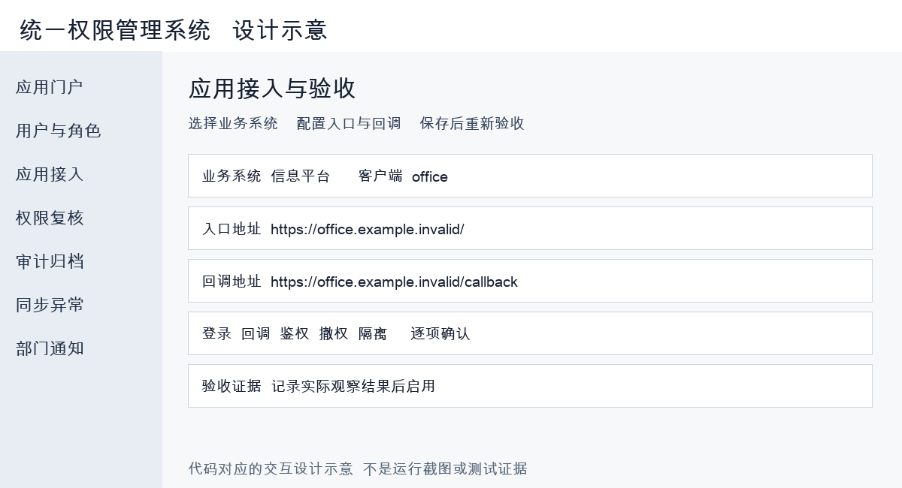
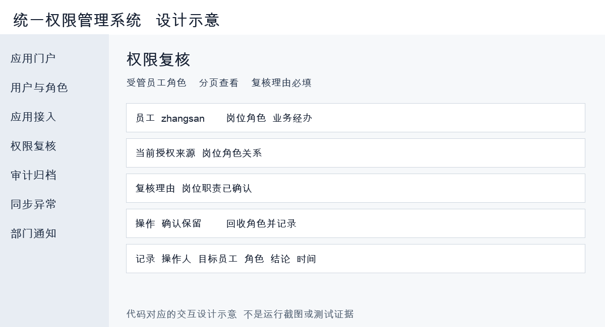
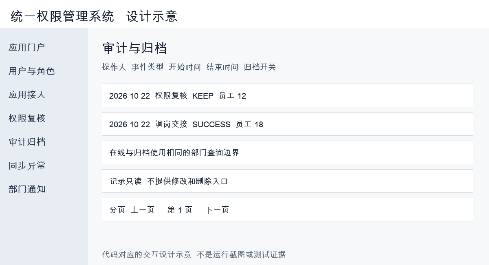

= 统一权限管理系统：界面设计
:lang: zh-CN
:toc: left
:toc-title: 目录
:sectnums:
:sectanchors:
:source-highlighter: highlight.js
:icons: font

小组成员：温家正、姚景云、杜奕含、陈浩贤。

文档整理日期：2026-10-28。测试及部署日期以相应记录为准。

== 页面结构与身份

前端为 Vue 3 + TypeScript + Tailwind，构建资源位于后端 `static/ui`；界面与 API 同源。
登录后读取本人身份、具名管理能力和有效业务权限；首次改密账号进入个人中心。

[cols="2,4,4",options="header"]
|===
|身份 |页面范围 |后台边界
|超级管理员 |用户、角色、权限、组织、应用接入、管理员成员、审计、同步和复核 |内置管理员受保护；业务权限不自动授予
|部门管理员 |受管员工、密码发放、会话、授权、复核、审计及组织只读 |仅显式绑定部门；不能维护其他管理员；不自动包含子部门
|普通员工 |应用门户、本人权限、本人会话、个人资料与密码、OA 申请状态 |只能访问本人数据及获授权业务功能
|===

== 页面与交互

[cols="2,4,4",options="header"]
|===
|页面 |主要输入或动作 |结果与异常反馈
|登录与个人中心 |账号/唯一手机号、密码；本人改密 |失败提示、锁定提示；改密后旧会话失效
|用户与初始密码 |按部门查员工、停用、下线、一次性领取密码 |执行范围检查；重复领取不再次返回已发放密码
|角色与权限 |维护角色、权限点；配置用户角色与角色权限 |重复操作幂等；失效点不可新授权；引用冲突提示
|组织与三表导入 |部门、岗位、员工表和权限清单预览后确认 |先展示错误警告；不自动授予员工角色；确认后事务提交
|功能权限目录 |按系统、模块、功能、操作浏览和搜索 |“无”不授予；“全部”只展开已有具体操作
|应用接入与门户 |clientId、入口、回调、协议、密钥及验收证据 |密钥不回显；修改后待验收；门户需启用、验收、授权
|OA 申请状态 |查看已登记申请，跳转 OA 发起 |没有可用 OA 入口时提示配置；平台不自建审批流
|复核与审计 |员工角色、KEEP/REVOKE、理由；时间类型过滤 |复核提交重新检查关系；归档与在线范围一致
|同步异常与通知 |请求编号、摘要、状态和处理原因 |不展示原始 HR 报文或密钥；源系统修复后重新签名发送
|会话与异常页 |查看本人/受管会话、下线；403/404 |403 保留身份；401 尝试刷新，失败回到登录
|===

== 当前流程设计示意

下列图片为 2026-10-22 的界面设计示意，用于说明交互流程。
页面实现位于 `App.vue` 与 `CompletionPanel.vue`；现有验证记录不包含逐页浏览器回归。

.应用接入配置与人工验收

.员工角色逐项复核

.在线与归档审计查询

== 前后端一致性

新增、编辑、设置密码和角色分配等表单使用居中对话框展示，支持取消和 Escape 关闭；错误信息显示在表单内，避免表单落在长表格下方不可见。
批量导入期间展示等待提示并禁用重复提交；关闭页面不等于取消后端事务。

导航或按钮隐藏仅改善交互；服务端仍复核身份、目标用户、部门范围及委派上限。
写入期间防止重复点击；成功后重新查询。409 表示引用或重复冲突，提示用户刷新数据。
授权变化后旧 JWT 返回 401，前端可以旋转仍有效会话；会话已撤销则需重新登录。
